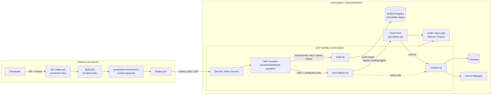

[[Home]]

#cloud #aws #oci #gcp #architecture #weekly #deep-dive

# Weekly Cloud Engineer Magazine — 2026-10-16

> [!summary] 今週の一問
> 工事現場の安全点検報告APIを更新するCI/CDに、ダウンロード可能なサービスアカウント鍵を1本も渡さず、**特定組織・リポジトリ・ブランチの、承認済み本番ジョブだけ**を15分未満の権限でデプロイさせられるか。今週の主軸はIAM、特に外部ワークロードの信頼条件と権限の分離である。

> [!warning] 課金・破壊的操作・認証情報
> 標準ラボはローカルのポリシー評価までで無料。任意のGCP展開では Cloud Run、Artifact Registry、Cloud Logging、Secret Manager などに課金され得る。**作成前に**学習用プロジェクト、請求先、予算通知、リージョン、ラベルを確認する。IAM binding の削除、Workload Identity Pool/Provider の削除、Cloud Run revision の削除は検証環境だけで行う。`roles/owner`、長期サービスアカウント鍵、実GitHub組織、実住民情報、実シークレットは使わない。本文のIDはすべてダミーである。

## 1. アプリ、主クラウド、焦点、難易度、前提、到達点

- **アプリ:** 建設会社向け「現場安全点検報告API」。現場監督がチェックリスト結果を登録し、安全管理者が是正措置を承認する。今回は業務機能そのものではなく、このAPIを安全に更新するデプロイ経路を扱う。
- **主実装クラウド:** **Google Cloud**、東京 `asia-northeast1`。Cloud Run + Artifact Registry + Firestore（Native mode）を想定する。
- **主 criterion:** **IAM — GitHub Actions OIDC → Workload Identity Federation（WIF）→ 専用デプロイサービスアカウントの短期 impersonation**。認証主体を「GitHub全体」ではなく、組織・リポジトリ・ブランチ・環境で絞り、ビルド主体と本番デプロイ主体を分離する。
- **難易度シグナル:** **Intermediate**。参加資格ではなく、OIDC claim、信頼ポリシー、resource-level authorization を同時に扱う密度の目安。
- **推定時間:** **165分**（Foundation 30分 → Practical implementation 85分 → Production concerns 35分 → Optional advanced challenge 15分）。

### 必要知識・ツール・環境・先行概念

- **必要知識:** JWTの `iss` / `aud` / `sub`、OIDC、IAM principal/role/resource、allow policy、サービスアカウント impersonation、Git branch と protected environment。
- **ツール:** Python 3.11+、`jq`、Git、Docker（任意）、`gcloud` 490+（クラウド拡張のみ）、任意のエディタ。
- **環境:** ローカル2 vCPU/2 GiB。任意展開は組織本番から分離したGCPサンドボックスと、使い捨ての演習用GitHub repository。
- **先行概念:** 認証は「誰か」、認可は「何をできるか」。OIDC tokenを受理する条件と、受理後に与えるroleは別の制御面。CIの `id-token: write` はGCP権限そのものではない。サービスアカウント鍵を消しても、広すぎるfederation条件なら安全にならない。
- **前号との関係:** ネットワーク境界、データ整合性、compute choiceは参考になるが必須ではない。今回はtopic-basedでIAMだけを深掘りする。

### 測定可能な到達目標

1. 正規の `acme-safety/site-safety-api`、`main`、`production` claimだけが token exchange を通り、fork、別repository、feature branchは拒否される。
2. ビルド主体はArtifact Registryへのpushだけ、本番デプロイ主体は既存imageのCloud Run revision更新だけを行える。
3. ランタイム主体はFirestoreの業務collectionと指定Secretの参照だけを許可され、デプロイやIAM変更はできない。
4. Cloud Audit Logsから「外部subject → impersonated service account → Cloud Run更新」を1本の調査手順で追跡できる。

### 学習レイヤー

**Foundation** → trust と permission を分け、OIDC claimsを読む。  
**Practical implementation** → claim正規化、attribute condition、role matrix、負のテストを作る。  
**Production concerns** → 承認、監査、失効、break-glass、コスト、障害対応を設計する。  
**Optional advanced challenge** → direct resource access と impersonation を比較し、組織ポリシーで鍵作成を抑止する。

## 2. 要件、負荷、SLO/RTO/RPO、コンプライアンス、予算

### 機能要件

1. 点検報告の作成・参照、是正措置の承認、監査履歴の参照。
2. `main` への署名付きrelease tagからstagingへ自動デプロイ。
3. GitHub `production` environmentの承認後だけ本番へpromote。
4. 同じimage digestをstagingとproductionで使い、productionで再buildしない。

### 非機能要件と明示的仮定

|項目|仮定・目標|
|---|---|
|利用規模|200現場、3,000利用者|
|API負荷|平常5 req/s、ピーク50 req/s、月100万request|
|payload|平均12 KiB、最大256 KiB|
|デプロイ|週5回、緊急時1日3回まで|
|API SLO|月99.9%、p95 500 ms以下|
|デプロイSLO|承認後10分以内にrollout、失敗検知5分以内|
|RTO|API 30分、誤デプロイ15分（直前revisionへ戻す）|
|RPO|Firestore業務データ5分、コンテナimage 0（digest保存）|
|コンプライアンス仮定|日本国内保管、点検者IDは個人情報。PCI DSS・医療情報は対象外。監査ログ400日、業務記録7年は別途ライフサイクル設計|
|予算枠|学習環境 月US$10以下、本番概算 月US$50–120。為替・税・ログ量・Firestore読書き・egressは別確認|

**信頼上の不変条件:** (a) 長期鍵ゼロ、(b) production deployはGitHub Environment承認を必須、(c) build/deploy/runtimeの3主体を兼務させない、(d) IAM変更はCI経路の外、(e) fork由来tokenは拒否。

## 3. ADR-042: 外部CIの本番デプロイ認証

### 検討した選択肢

|選択肢|利点|主要リスク・運用負荷|
|---|---|---|
|A. JSONサービスアカウント鍵をGitHub Secretへ保存|設定が簡単、古いtoolでも動く|漏洩まで長期間有効、複製検知が難しい、rotationが必要|
|B. GitHub OIDC + WIF + deploy SA impersonation|短期資格情報、claim条件、既存tool互換性、監査主体を追跡可能|provider条件とSA bindingの二層を正しく設計する必要|
|C. GitHub OIDC principalへCloud Run権限を直接付与|SA hopを減らせる、鍵不要|対応API・toolの制約確認が必要、複数resource権限の管理が散らばりやすい|
|D. Cloud Build repository trigger|GCP内部の実行主体に寄せられる|既存GitHub workflow変更、trigger接続と承認モデルを再設計|

### 決定

**Bを採用**する。専用WIF pool/providerでGitHub OIDC tokenを受理し、providerのattribute conditionで `repository_owner_id` と `repository_id` を不変IDで固定する。表示名だけに依存しない。`ref == refs/heads/main` と `environment == production` を本番経路で要求し、federated principalには `roles/iam.workloadIdentityUser` を本番deploy SA上だけに与える。deploy SAには最小のCloud Run更新権限と、runtime SAを指定するための限定 `iam.serviceAccounts.actAs` を付与する。

### トレードオフ

- impersonationは一段増えるが、多くのCLIとの互換性と中央監査を得る。
- GitHub claim schemaとGCP CEL条件にロックインする。境界の正規形は「issuer、audience、stable repository ID、ref、environment」と文書化し、他cloudへ移植可能にする。
- predefined `roles/run.admin` は便利だが広い。初期構築では使用範囲を本番serviceに限定し、成熟後は必要permissionを観測してcustom roleへ縮小する。

### 却下

- **A:** 長期鍵ゼロという不変条件に反する。
- **C:** 今回使うdeploy tool chainとAPI対応差を吸収するため見送る。高度課題で再評価する。
- **D:** 有力だが、今回はGitHub Actionsを既存制約とし、IAM境界に集中する。

## 4. 詳細アーキテクチャとフロー



### Request/data flow

1. 開発者はPRを作り、CODEOWNERS reviewとテストを通す。
2. build jobがGitHub OIDC tokenを取得。WIF providerはissuer/audienceとstable repository claimを検証する。
3. STSの短期tokenで `build-sa` をimpersonateし、imageをpush。生成した**digest**をprovenanceと共に保存する。
4. `production` environmentの人手承認後、deploy jobが別tokenを取得。`main`・対象repository・environment条件を満たす場合だけ `prod-deploy-sa` をimpersonateする。
5. deploy SAは指定digestでCloud Run revisionを作り、runtime SAをattachする。sourceから再buildしない。
6. Cloud Runはruntime SAとしてFirestore/Secret Managerへアクセス。外部GitHub tokenはランタイムへ渡らない。
7. 監査ログにはSTS/SA impersonationとCloud Run更新を残し、application logsにはtokenや点検本文を出さない。

## 5. IAM、信頼境界、暗号化、ネットワーク、secrets、telemetry

### 主体と最小権限matrix

|主体|許可|明示的に持たせない|
|---|---|---|
|GitHub build principal|`build-sa` impersonation|Cloud Run deploy、Firestore、IAM変更|
|`build-sa`|対象repositoryへのimage upload、digest参照|production deploy、SA actAs|
|GitHub prod principal|`prod-deploy-sa` impersonation|build SA、runtime SA impersonation|
|`prod-deploy-sa`|対象Cloud Run service更新、対象runtime SAのactAs、image read|IAM policy変更、Secret payload読取、他service deploy|
|`runtime-sa`|指定Firestore data、指定Secret version access、telemetry送信|Artifact push、deploy、IAM変更|
|人間platform admin|WIF/IAM変更（PIM/JIT推奨）|日常deploy、業務データ閲覧|

**provider condition例（概念。実claim名はGitHub/GCP公式文書で当日確認）:**

```cel
assertion.repository_owner_id == "1234567" &&
assertion.repository_id == "7654321" &&
assertion.ref == "refs/heads/main"
```

本番SA bindingでは、さらにproduction用に写像した `attribute.environment/production` のprincipal setだけを許可する。provider条件はtokenをpoolへ入れる入口、SA bindingはどのSAを使えるかの出口であり、片方だけに全防御を寄せない。

### Trust boundary

1. 開発者端末 → GitHub: PR review、branch protection、MFA。
2. GitHub issuer → WIF provider: TLS、issuer、audience、署名、stable ID、ref/environment。
3. Federated principal → deploy SA: `roles/iam.workloadIdentityUser` のresource-level binding。
4. deploy SA → Cloud Run: deploy permission と限定actAs。
5. runtime SA → data/secrets: runtime専用permission。

### 暗号化・network・secrets

- 通信はTLS。保存時はGoogle-managed encryptionを標準とし、規制で必要な場合だけCMEKと鍵運用を追加する。
- Cloud Run ingressは外部LB経由または認証済み呼出しへ限定。IAMはnetwork firewallの代替ではない。
- Secret Managerには外部通知先credentialのみ。GitHub OIDC token、federated access tokenを永続保存しない。
- imageはdigest pinning。Artifact Registry immutable tags、Binary Authorization/SLSA provenanceは高度課題。
- egressは必要先を列挙し、VPC経由化は脅威と費用が正当化する場合に採用する。

### Logs / metrics / traces

- **監査:** `principalSubject`、impersonated SA、`GenerateAccessToken`相当、Cloud Run update、IAM policy change。Data Access logsは対象serviceと費用を確認して有効化。
- **ログ:** `deployment_id`, `git_sha`, `image_digest`, `revision`, `actor_subject`, `decision`。JWT本文、Authorization header、点検本文は記録禁止。
- **メトリクス:** token exchange拒否数、deploy成功率/所要時間、revision error rate、IAM policy change数、SA key作成数（目標0）。
- **トレース:** API requestはOpenTelemetry。CI認証traceと顧客request traceを混ぜず、deployment markerで相関する。

## 6. Capacity / cost model

> [!info] すべて見積もり
> 価格は2026-10-16参照時点の公式ページに基づく説明用仮定。実請求はSKU、リージョン、free tier、為替、税、billing modeで変わる。作成直前に [Cloud Run pricing](https://cloud.google.com/run/pricing) と Pricing Calculator で東京リージョンを再確認する。

### 容量仮定

- 月100万request × 平均0.4秒 = **400,000 request-seconds**。
- 1 instance = 1 vCPU / 512 MiB、concurrency 20。平均同時実行は `5 req/s × 0.4s = 2`、ピークは `50 × 0.4 = 20`。理論上ピーク1 instanceだが、cold start、headroom、長いrequestを考えmax 10、通常2前後を想定。
- CPU active比率25%と仮定: `400,000 × 0.25 = 100,000 vCPU-s`。
- memory: `400,000 × 0.5 = 200,000 GiB-s`。
- response/request payload 12 KiB × 100万 ≈ **11.4 GiB/月**（二進換算前の概算）。保存・egress・ログを別に見積もる。

### Cloud Runの例示計算

公式概要に表示される代表単価（US$0.000018/vCPU-s、US$0.000002/GiB-s。適用tier/regionを要確認）を機械的に当てると:

- CPU: `100,000 × 0.000018 = US$1.80`
- memory: `200,000 × 0.000002 = US$0.40`
- 小計 **US$2.20/月（free tier適用前、request、network、ログ、DB、Artifact Registry等を除外）**

これは請求予測ではなくorder-of-magnitude検算である。実運用予算US$50–120の主要変動要因はFirestore operations/storage、ログ保持と取り込み、external egress、minimum instances、Secret Manager access、build/storageである。IAM/WIFの設計価値はcompute節約でなく、鍵漏洩と権限濫用のblast radius削減にある。

**FinOps guardrails:** `env`, `service`, `owner`, `cost-center` label、月50/80/100%予算通知、log exclusionはセキュリティログを除外しない、staging min-instances=0、不要image保持期間30日（digest evidence要件と調整）。予算通知はhard stopではない。

## 7. 165分ガイドラボ

### 0–30分: Foundation — 信頼仕様を書く

1. 次の許可tupleを紙または`trust.json`に定義する（実ID禁止）。

```json
{
  "issuer": "https://token.actions.githubusercontent.com",
  "audience": "//iam.googleapis.com/projects/111111111111/locations/global/workloadIdentityPools/gh-prod/providers/github",
  "owner_id": "1234567",
  "repository_id": "7654321",
  "ref": "refs/heads/main",
  "environment": "production"
}
```

2. attack casesを4つ作る: fork、repository rename後の偽同名repo、feature branch、production承認なし。
3. build/deploy/runtime/adminのrole matrixを転記し、兼務を見つける。

**Checkpoint A:** 許可tupleの各fieldが、issuer検証・provider condition・SA binding・GitHub controlのどこで検査されるか説明できる。  
**期待結果:** 表示名だけでなくstable numeric IDを使う理由を説明できる。  
**検証:** 4 attack casesすべてに拒否点が1つ以上ある。

### 30–75分: Practical — ローカルpolicy evaluator

`policy.py`を次のように作る（教材用であり、GCP CEL実装ではない）。

```python
import json, sys

ALLOW = {
    "iss": "https://token.actions.githubusercontent.com",
    "aud": "gcp-wif-prod",
    "repository_owner_id": "1234567",
    "repository_id": "7654321",
    "ref": "refs/heads/main",
    "environment": "production",
}

claims = json.load(sys.stdin)
failed = [k for k, v in ALLOW.items() if claims.get(k) != v]
print(json.dumps({"allow": not failed, "failed": failed}))
raise SystemExit(bool(failed))
```

正規caseと4つのnegative fixtureを作り、`python policy.py < fixture.json`を実行する。CIではdeny caseがexit 1であることを期待値として扱う。

**Checkpoint B:** 正規caseだけexit 0、fork/別repo/feature/no-environmentはexit 1。  
**Validation:** 値を空にしたcase、未知field追加、`main ` のような境界値も試す。fail closedでなければ修正する。

### 75–115分: Practical — GCP設計または任意サンドボックス展開

> [!warning] ここから任意・課金可能
> 実行前に `gcloud config get-value project` と請求先を確認する。コマンドのダミー値をそのまま実行しない。WIF/IAMを作れる強権限はbootstrap時だけJITで使い、ラボ後に外す。

設計のみの場合は以下をTerraform/pseudocodeへ落とす。実展開する場合は公式WIF deployment pipelineガイドの現行コマンドを優先する。

1. `gh-prod` poolとGitHub OIDC providerを作る。
2. claimsを `google.subject`, `attribute.repository_id`, `attribute.owner_id`, `attribute.ref`, `attribute.environment` へ写像する。
3. provider conditionでowner/repositoryのstable IDを固定。
4. `build-sa`, `prod-deploy-sa`, `runtime-sa`を作り、鍵は作らない。
5. federated principal setを各SAへresource-level binding。production bindingはenvironmentとrefを絞る。
6. GitHub workflowは `permissions: {contents: read, id-token: write}`、production jobに `environment: production`。checkout tokenの権限も縮小する。
7. image digestをoutputし、deploy jobはdigestだけを受け取る。

**Checkpoint C:** `gcloud iam service-accounts keys list`でuser-managed keyが0。  
**期待結果:** 正規jobは短期資格情報を得るが、別branchのjobはimpersonationで拒否。  
**Validation:** 成功だけでなく、別repository/ref/environmentの3 negative testを実行。ログにtokenがないことを確認。

### 115–150分: Production concerns — 証跡と失効

1. 監査queryを保存し、`git_sha → principalSubject → deploy SA → revision`を追う。
2. 「GitHub repository侵害」「誤binding」「deploy SA過権限」の失効順序を書く。
3. rollbackは直前の既知良好digestへtrafficを戻す手順とし、sourceからbuildし直さない。
4. break-glass groupは常時0名、JIT、有効期限、二者承認、事後reviewを定義。

**Checkpoint D:** 10分以内に特定subjectを止める操作を1つ選べる。provider disableは全体停止、SA binding削除は対象経路停止というblast radius差を説明できる。

### 150–165分: Optional advanced challenge

- deploy SA impersonationを使わず、federated principalへのdirect resource accessで同じ最小権限を表現し、対応API/toolと監査表示を比較する。
- 組織ポリシーでservice account key creation/uploadを抑止する案を追加する。
- artifact attestationとBinary Authorizationを加え、「認証済みjob」だけでなく「検証済み成果物」だけをdeployする。

### Cleanup

1. 最初に `project ID / pool / provider / SA / Cloud Run service` を一覧表示し、演習用であることを確認。
2. Cloud Run service、Artifact Registry image、不要ログsinkを削除。
3. SA bindingを先に外し、provider/pool、演習SAを削除。監査保持要件がある場合はログを消さない。
4. GitHub environment secretがないこと、repositoryのOIDC workflowを無効化/削除したことを確認。
5. billing reportとuser-managed SA key=0を確認。削除は復元不能になり得るため、実環境で実行しない。

## 8. Failure / recovery exercise とrunbook

### シナリオ: repository renameを悪用した同名repoからdeploy試行

攻撃者が許可repository名を変更後、元の名前で新repositoryを作り、`main`からOIDC tokenを取得したとする。conditionが `repository == "acme-safety/site-safety-api"` という可変名だけなら誤許可の余地がある。stable `repository_id` を要求すれば拒否できる。

### 演習

1. fixtureのrepository名は同じ、`repository_id`だけを`9999999`へ変更。
2. policy evaluatorと、可能ならWIF token exchangeを実行。
3. **期待:** exchangeまたはimpersonation拒否、Cloud Run revision増加0、Artifact push 0。
4. 監査でdeny event、subject、provider、時刻を確認する。

### 運用runbook

|時点|行動|判定・証跡|
|---|---|---|
|0–5分|deployをfreeze、GitHub environmentをdisable、incident ID発行|新revision数が増えない|
|5–10分|対象SA binding削除。広域侵害ならprovider disable|token exchange/impersonationが拒否|
|10–20分|最後の30日間のAudit Logsでsubject、SA、更新resourceを列挙|不正revision/image/IAM change一覧|
|20–30分|既知良好digestへrollback。runtime secretは露出根拠がある場合だけrotate|API error rate回復、revision digest一致|
|30分以降|stable ID conditionを修正、negative test追加、二者review後に再開|fork/rename/ref/environment testが全拒否|

**注意:** 無根拠な全secret rotationは復旧を遅らせる。まず外部tokenがruntime secretへ到達できたかpermissionとaudit evidenceで判断する。IAM policy変更自体が疑わしい場合は、同じCI identityで修復しない。

## 9. AWS / OCI / GCP 対応とportability

|責務|GCP（主実装）|AWS|OCI|
|---|---|---|---|
|外部OIDC trust|Workload Identity Pool/Provider + STS|IAM OIDC identity provider + STS `AssumeRoleWithWebIdentity`|Identity Domains federation/API signing設計。GitHub OIDCの同等経路は現行対応を要検証|
|短期deploy主体|service account impersonation|IAM role session|dynamic group/resource principalはOCI内workload向け。外部CIはOCI DevOps build pipeline等も比較|
|条件|CEL attribute condition + principalSet binding|role trust policyの`Condition`で`sub`/`aud`等|IAM policy `where` 条件、compartment/resource attributes|
|runtime identity|Cloud Run service account|ECS task role / Lambda execution role|resource principal + dynamic group|
|container registry|Artifact Registry|ECR|OCIR / Artifact Registry|
|serverless container|Cloud Run|App Runner / ECS Fargate|Container Instances / Functions（形状次第）|
|監査|Cloud Audit Logs|CloudTrail|Audit|

### portability / lock-in

- **移植しやすい:** OIDC issuer、audience、stable repository ID、branch/environment、短期credential、build/deploy/runtime分離、negative tests、digest promotion。
- **ロックイン:** GCP CEL、principal URI形式、service account impersonation、predefined role名、Audit Logs field名。
- **AWS差:** role trust policyでGitHub `sub` を絞る設計が中心。permission policyとtrust policyを混同しない。
- **OCI差:** OCI内runtimeはdynamic group/resource principalが強い。一方、外部GitHub OIDCからの直接federationを当然視せず、OCI DevOpsを信頼中継にする案も公式対応範囲・運用負荷で比較する。
- **結論:** YAMLを共通化するのではなく、`TrustSpec`（issuer/aud/stable repo/ref/env）、`PermissionSpec`、negative-test casesを共通成果物にする。

## 10. Well-Architected-style review / production readiness

### Operational excellence

- [ ] claim schema、owner、review期限を台帳化
- [ ] deploy/rollback/credential revocation runbookを四半期演習
- [ ] IAM変更はpull request + 二者review + policy lint
- [ ] 成功テストより先にfork/ref/environmentの負テストを自動化

### Security

- [ ] user-managed service account key = 0
- [ ] owner roleをCIへ付与していない
- [ ] provider conditionでissuer/aud/stable owner・repo IDを検証
- [ ] build/deploy/runtime SAを分離
- [ ] deploy SAのactAs対象をruntime SA一つへ限定
- [ ] GitHub workflowをcommit SHAでpinし、environment approvalを設定
- [ ] token、Authorization header、業務本文をlogへ出さない
- [ ] break-glassはJIT、期限付き、監査対象

### Reliability

- [ ] image digestを不変成果物として保存
- [ ] 直前revisionへのrollbackを15分以内に演習済み
- [ ] GitHub/WIF障害時は既存runtimeを維持し、危険な代替鍵を発行しない
- [ ] deploy timeout/部分成功時の状態確認手順がある

### Performance / cost

- [ ] concurrencyとmax instancesを下流Firestore容量に合わせる
- [ ] Cloud Run/Firestore/logging/egressを別々に予算化
- [ ] staging min instances=0、production cold-start要件を計測
- [ ] Audit/Data Access logの量と保持費用を見積もる

### Production readiness gate

- [ ] 正規deploy 1件とnegative test 4件の証跡
- [ ] SA key inventory 0件
- [ ] IAM recommender/permission usageをreviewし過権限を縮小
- [ ] platform adminとapplication developerの責任分界を承認
- [ ] 侵害時連絡先、停止権限、復旧責任者を明記

## 11. Concrete deliverables

1. `trust-spec.json`: issuer/audience/stable repository/ref/environment。
2. `role-matrix.md`: build/deploy/runtime/adminの許可・禁止。
3. `policy.py` とallow 1件/deny 4件以上のfixtures。
4. WIF provider、3 SA、resource bindingsのTerraformまたは設計pseudocode。
5. GitHub workflow断片（最小permissions、environment approval、digest promotion）。
6. capacity/cost worksheetと東京リージョン価格確認日。
7. Audit Logs query、incident runbook、rollback/revocation演習記録。
8. architecture MermaidとADR-042。

## 12. Assessment

### Q1
WIFを導入すれば、provider conditionが `repository_owner == "acme-safety"` だけでも十分か。

<details><summary>回答</summary>
不十分。public issuerでは別主体もtokenを得られるためownerを絞る必要があるが、それだけでは同じowner内の全repositoryが対象になる。stable owner/repository ID、audience、ref、environmentを段階的に検証し、さらに対象SA上のbindingを限定する。
</details>

### Q2
`id-token: write` をworkflowに設定するとGCPのdeploy権限が付くか。

<details><summary>回答</summary>
付かない。GitHubがjobへOIDC token発行を許すだけ。GCP側providerがtokenを受理し、federated principalが対象SAをimpersonateでき、そのSAがCloud Run更新権限を持って初めてdeployできる。
</details>

### Q3
build SAとdeploy SAを分ける主な理由は何か。

<details><summary>回答</summary>
build環境が侵害されても本番更新まで直結させないため。buildはimage push、deployは既存digestのpromoteだけにすれば、権限と証跡、承認点を分離できる。
</details>

### Q4
repository名よりnumeric repository IDを優先する理由は何か。

<details><summary>回答</summary>
表示名はrename・再利用され得るがstable IDは元resourceを識別するため。同名repositoryを作り直すrename/reuse attackへの耐性が上がる。
</details>

### Q5
WIF障害時、緊急用JSON keyをGitHub Secretへ追加するのがよいか。

<details><summary>回答</summary>
原則しない。既存revisionは動作を継続するため、deploy停止を受容し復旧する方が安全。break-glassが必要なら人間のJIT federated access、二者承認、短い期限、完全監査を事前設計する。長期鍵は障害後も残る別の事故を作る。
</details>

### Design / interview question

「GitHub organizationは共有、repositoryは200、production projectは20ある。1 poolに集約するか、環境/事業単位でpoolを分けるか。blast radius、管理量、claim変更、監査、quota、失効速度を使って設計せよ。」

評価観点: pool数の唯一解ではなく、(1) trust boundaryを明示、(2) stable attributeを採用、(3) provider全停止と個別binding削除のblast radiusを比較、(4) permissionをresource側で絞る、(5) 自動negative testとownerを定めること。

### Follow-up challenge

同じ`TrustSpec`から、GCP CEL conditionとAWS IAM role trust policyを生成する小さなvalidatorを作る。許可例1件、fork/別repo/feature/no-environment/誤audienceの拒否例5件を両cloudで同じ期待値にする。OCIは「直接同等化できる」と仮定せず、OCI DevOps中継案とresource principalの適用範囲をADRへ追記する。

## 13. Current official references

### Google Cloud（主実装）

- [Workload Identity Federation overview](https://cloud.google.com/iam/docs/workload-identity-federation)
- [Configure WIF with deployment pipelines](https://cloud.google.com/iam/docs/workload-identity-federation-with-deployment-pipelines)
- [Best practices for WIF](https://cloud.google.com/iam/docs/best-practices-for-using-workload-identity-federation)
- [IAM Conditions overview](https://cloud.google.com/iam/docs/conditions-overview)
- [Service account impersonation](https://cloud.google.com/iam/docs/service-account-impersonation)
- [Cloud Run service identity](https://cloud.google.com/run/docs/securing/service-identity)
- [Cloud Run pricing](https://cloud.google.com/run/pricing)
- [Cloud Audit Logs overview](https://cloud.google.com/logging/docs/audit)
- [Google Cloud documentation root](https://cloud.google.com/docs)

### AWS（対応関係）

- [IAM OIDC federation](https://docs.aws.amazon.com/IAM/latest/UserGuide/id_roles_providers_oidc.html)
- [Create a role for OIDC federation](https://docs.aws.amazon.com/IAM/latest/UserGuide/id_roles_create_for-idp_oidc.html)
- [IAM roles for tasks](https://docs.aws.amazon.com/AmazonECS/latest/developerguide/task-iam-roles.html)
- [AWS documentation root](https://docs.aws.amazon.com/)

### OCI（対応関係）

- [Managing Dynamic Groups](https://docs.oracle.com/en-us/iaas/Content/Identity/Tasks/managingdynamicgroups.htm)
- [Calling services from an instance](https://docs.oracle.com/en-us/iaas/Content/Identity/Tasks/callingservicesfrominstances.htm)
- [OCI IAM policies overview](https://docs.oracle.com/en-us/iaas/Content/Identity/Concepts/policies.htm)
- [OCI documentation root](https://docs.oracle.com/en-us/iaas/Content/home.htm)

> 参照確認日: 2026-10-16。サービス仕様、claim、role、pricingは変更される。ラボ実行日に必ず公式ページを再確認する。
