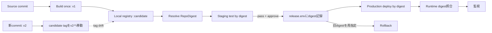

# Weekly Docker Magazine — タグを配るな、検証済みのバイト列を配れ

#docker #containers #weekly #deep-dive

[[Home]]

> [!warning] 削除操作と秘密情報
> `docker system prune` / `docker image prune` / `docker rmi` / `docker rm -f` は、別プロジェクトの資産や稼働サービスを消し得る。実行前に `docker ps -a`、`docker image ls`、対象名を確認する。本ラボでは project 名と明示したコンテナ名だけを cleanup する。
>
> registry token、パスワード、秘密鍵を Dockerfile、build context、image layer、`ARG`、`ENV`、`compose.yaml`、Git 管理ファイルへ埋め込まない。本ラボのローカル registry は教材専用で認証なし。本番では registry の credential helper / CI secret store を使う。

## 1. Focus・難易度・前提・測定可能な成果

### 今週の単一本番基準

> **一度 build して registry へ push したイメージを digest で staging から production へ昇格し、可変 tag が別イメージを指しても、承認済み digest だけを再現可能に deploy / rollback できること。**

**難易度シグナル: Intermediate** — 学習量の案内であり参加条件ではない。今回必要なのは Kubernetes ではなく、Docker image reference、registry、Compose の理解である。

### 必要知識・ツール・環境・先行概念

- **知識:** image と container、tag、SHA-256、HTTP health check、終了コード
- **ツール:** 現行 Docker Engine / Docker Desktop、Compose v2、`curl`、POSIX shell、`awk`、`time`
- **環境:** Linux container を実行できる端末、空き RAM 1 GiB、disk 2 GiB、`127.0.0.1:5000` と `127.0.0.1:18080` が空いていること
- **先行概念:** Dockerfile、Compose service、healthcheck、registry への push/pull、multi-stage build（今回は必須ではない）
- **接続する以前の概念:** SBOM/provenance は「何を・どう作ったか」を説明する。本号の digest pin は「検証した同じ内容を配ったか」を同一性で保証する。署名は「誰が承認したか」を追加する別レイヤーである。

### 150分後に残る測定可能な成果

1. `candidate` tag と承認済み digest の違いを実測できる。
2. tag を v2 へ動かしても production が v1 digest のままであることを証明できる。
3. deployment manifest、稼働 container、registry の3点で digest を照合できる。
4. 誤 digest を fail-closed で停止し、承認済み digest へ5分以内に rollback できる。
5. build回数、image size、pull/deploy時間、HTTP test結果をリリース証跡として残せる。

---

## 2. 実アプリケーションの状況と制約

チームは小さな release-info API を staging で検証し、同じ artifact を production へ移したい。現在は両環境が `promo-app:candidate` を使うため、tag の付け替え、再build、local cache の差で「stagingで見たもの」と「productionで動くもの」が一致しない。

制約:

- build は commit ごとに **1回だけ**。環境別の再buildは禁止。
- staging 合格後は image content を変更せず production へ昇格する。
- production の入力は人間向け tag ではなく、監査可能な `repository@sha256:...`。
- rollback は再buildせず、直前の承認済み digest を指定する。
- tag の可読性は残すが、正しさの根拠にはしない。
- digest固定は security update を自動取得しない。更新botや定期rebuildで意図的に更新する。

## 3. Container / registry のメンタルモデル

`repository:tag` は registry 内の **可変ポインタ**。同じ tag を後から別manifestへ付け替えられる。一方 `repository@sha256:digest` は manifest content を指す不変識別子で、内容が1 byteでも変われば digest が変わる。

```text
candidate tag ──(今は)──> manifest v1 ──> config + layers
      │
      └────(後で付替)──> manifest v2 ──> config + layers

sha256:v1 ─────────────> manifest v1     # 指し先は変わらない
```

区別すべき3つの値:

- **image ID:** local image configuration のhash。registry参照のmanifest digestと同一とは限らない。
- **RepoDigest:** `repository@sha256:...`。push/pullしたregistry上の内容参照。
- **container Image field:** container作成時に解決した image reference / ID。deploy後に照合する。

tag を digest に固定しても、runtime configuration、secret、volume data、network policy は別物である。また digest は完全性と同一性を与えるが、publisher identity や安全性を単独では保証しない。

## 4. 設計案と明示的なtrade-off

| 案 | 再現性 | 更新性 | 運用上の注意 |
|---|---:|---:|---|
| `:latest` + 常時pull | 低 | 高 | 意図しない変更、rollback対象が曖昧 |
| version tag (`:1.4.2`) | 中 | 中 | tagを上書きできるregistryでは不変保証なし |
| digestのみ | 高 | 手動 | 人が読みにくい、更新漏れを仕組みで補う |
| version tag + digest | 高 | 明示的 | 可読性と不変性を両立。本号の推奨 |

`pull_policy: always` は「registryを毎回確認する」設定であって、tagを不変にしない。digest固定と組み合わせれば、cacheに依存せず同じcontentを取得する意図が明確になる。ただしoffline nodeでは可用性とのtrade-offがある。

## 5. build / 昇格フロー



---

## 6. Guided Lab（約150分）

### 時間配分

- Foundation 25分: registry / digest観測
- Practical implementation 65分: build-once、test、deploy、tag drift
- Production concerns 40分: 証跡、失敗注入、rollback、計測
- Optional advanced challenge 20分: CI policy化

### 6.1 Preflight と作業ディレクトリ（10分）

```bash
docker version
docker compose version
curl --version
mkdir -p digest-promotion-lab/app
cd digest-promotion-lab
```

**checkpoint:** Docker daemonへ接続でき、Compose v2が表示される。port確認は Linux なら `ss -ltn | grep -E ':(5000|18080) ' || true`。既に使われていたら他の空きportへ全ファイルを一貫して変更する。

### 6.2 完全なsample files（15分）

`app/server.py`:

```python
import json
import os
from http.server import BaseHTTPRequestHandler, HTTPServer

VERSION = os.environ.get("APP_VERSION", "unknown")

class Handler(BaseHTTPRequestHandler):
    def do_GET(self):
        if self.path not in ("/", "/healthz"):
            self.send_response(404); self.end_headers(); return
        body = json.dumps({"version": VERSION, "path": self.path}).encode()
        self.send_response(200)
        self.send_header("Content-Type", "application/json")
        self.send_header("Content-Length", str(len(body)))
        self.end_headers()
        self.wfile.write(body)
    def log_message(self, fmt, *args):
        print(json.dumps({"event": "http", "message": fmt % args}), flush=True)

HTTPServer(("0.0.0.0", 8080), Handler).serve_forever()
```

`Dockerfile`:

```dockerfile
# syntax=docker/dockerfile:1
FROM python:3.13-alpine
ARG APP_VERSION
RUN addgroup -S app && adduser -S -G app app
WORKDIR /app
COPY --chown=app:app app/server.py ./server.py
ENV APP_VERSION=${APP_VERSION}
USER app
EXPOSE 8080
CMD ["python", "/app/server.py"]
```

`.dockerignore`:

```text
.git
evidence
release.env
compose.yaml
```

`compose.yaml`:

```yaml
services:
  api:
    image: ${IMAGE_REF:?set IMAGE_REF to an approved repository@sha256 digest}
    pull_policy: always
    ports:
      - "127.0.0.1:18080:8080"
    read_only: true
    cap_drop: [ALL]
    security_opt:
      - no-new-privileges:true
    healthcheck:
      test: ["CMD", "python", "-c", "import urllib.request; urllib.request.urlopen('http://127.0.0.1:8080/healthz')"]
      interval: 2s
      timeout: 2s
      retries: 10
      start_period: 3s
```

`test.sh`:

```sh
#!/bin/sh
set -eu
expected="$1"
actual="$(curl -fsS http://127.0.0.1:18080/ | sed -n 's/.*"version": "\([^"]*\)".*/\1/p')"
test "$actual" = "$expected"
printf 'PASS expected=%s actual=%s\n' "$expected" "$actual"
```

```bash
chmod +x test.sh
mkdir -p evidence
docker compose config >/dev/null 2>&1 && echo "unexpected" || echo "PASS: IMAGE_REFなしではfail-closed"
```

**期待出力:** `PASS: IMAGE_REFなしではfail-closed`

### 6.3 教材用registryを起動（10分）

```bash
docker run -d --name digest-lab-registry \
  -p 127.0.0.1:5000:5000 \
  --restart=no registry:2
curl -fsS http://127.0.0.1:5000/v2/ && echo "registry OK"
```

- `-d`: background実行。
- `--name`: cleanup対象を曖昧にしない固定名。
- `127.0.0.1:5000:5000`: 外部interfaceへ公開しない。
- `--restart=no`: host再起動後に教材用の認証なしregistryを残さない。
- `/v2/`: Registry HTTP APIの疎通確認。

**期待出力:** `{}` に続いて `registry OK`。

### 6.4 v1を一度だけbuild / pushし、digestを保存（20分）

```bash
time docker build \
  --build-arg APP_VERSION=v1 \
  -t localhost:5000/promo-app:candidate . \
  2>&1 | tee evidence/build-v1.log

docker push localhost:5000/promo-app:candidate | tee evidence/push-v1.log
docker pull localhost:5000/promo-app:candidate
V1_REF="$(docker image inspect localhost:5000/promo-app:candidate \
  --format '{{index .RepoDigests 0}}')"
printf 'IMAGE_REF=%s\n' "$V1_REF" | tee release.env evidence/approved-v1.env
printf '%s\n' "$V1_REF"
```

- `--build-arg APP_VERSION=v1`: 教材用versionをbuild inputにする。secretには使わない。
- `-t ...:candidate`: 人向けの一時tag。
- `push`: registryへmanifest/layersを保存し、registry digestを確定する。
- `pull`: local metadataに `RepoDigests` を確実に持たせる。
- `index .RepoDigests 0`: `repository@sha256:...` 形式を取り出す。
- `release.env`: 承認対象。実務ではGitのdeployment manifestやrelease recordへ更新PRを作る。

**checkpoint:** `release.env` は `IMAGE_REF=localhost:5000/promo-app@sha256:...`。`:candidate` だけなら失敗。

### 6.5 staging test後に同じdigestをproduction相当へdeploy（20分）

```bash
set -a
. ./release.env
set +a

docker pull "$IMAGE_REF"
docker run --rm -d --name digest-lab-staging -p 127.0.0.1:18081:8080 "$IMAGE_REF"
sleep 2
curl -fsS http://127.0.0.1:18081/
docker stop digest-lab-staging

time docker compose -p digest-promotion up -d --pull always 2>&1 | tee evidence/deploy-v1.log
./test.sh v1 | tee evidence/test-v1.log
docker compose -p digest-promotion ps
docker inspect digest-promotion-api-1 \
  --format 'image-id={{.Image}} configured={{.Config.Image}}' | tee evidence/runtime-v1.txt
```

`set -a` は読み込んだ変数を子processへexportする。`--rm` は正常停止した一時staging containerだけを自動削除する。production相当のComposeは同じ `$IMAGE_REF` を使い、再buildしない。

**期待出力例:** `{"version": "v1", ...}`、`PASS expected=v1 actual=v1`、health列が最終的に `healthy`。

### 6.6 tag driftを注入して不変性を証明（20分）

```bash
time docker build --build-arg APP_VERSION=v2 \
  -t localhost:5000/promo-app:candidate . \
  2>&1 | tee evidence/build-v2.log
docker push localhost:5000/promo-app:candidate | tee evidence/push-v2.log
docker pull localhost:5000/promo-app:candidate
V2_REF="$(docker image inspect localhost:5000/promo-app:candidate \
  --format '{{index .RepoDigests 0}}')"
printf 'v1=%s\nv2=%s\n' "$V1_REF" "$V2_REF" | tee evidence/digests.txt
test "$V1_REF" != "$V2_REF" && echo "PASS: tag moved to different content"

docker compose -p digest-promotion up -d --pull always
./test.sh v1
```

**checkpoint:** `candidate` は v2 を指すが、Composeは `release.env` の v1 digestをpullし、APIはv1を返す。これがbuild-once promotionの核である。

### 6.7 明示的昇格とrollback（20分）

```bash
printf 'IMAGE_REF=%s\n' "$V2_REF" > release.env
set -a; . ./release.env; set +a
docker compose -p digest-promotion up -d --pull always --force-recreate
./test.sh v2

# smoke test失敗を想定し、再buildせず承認済みv1へ戻す
cp evidence/approved-v1.env release.env
set -a; . ./release.env; set +a
time docker compose -p digest-promotion up -d --pull always --force-recreate \
  2>&1 | tee evidence/rollback.log
./test.sh v1 | tee evidence/test-rollback.log
```

- `--force-recreate`: reference更新後のcontainer置換を明示する。
- rollback はtagを付け替えず、既知のdigestをdeployment inputへ戻す。
- 実本番ではatomic/rolling deployment、connection draining、DB migration互換性が別途必要。

### 6.8 cleanup（5分）

> [!warning] cleanup前確認
> 次の対象名がこのラボのものか `docker compose -p digest-promotion ps -a` と `docker ps -a --filter name=digest-lab` で確認する。`docker rm -f`、`docker rmi`、各種`prune`は使わない。

```bash
docker compose -p digest-promotion down --remove-orphans
docker stop digest-lab-registry
docker rm digest-lab-registry
```

source、`evidence/`、local imagesは検証記録として残る。削除する場合も `docker image ls localhost:5000/promo-app` で対象を確認し、明示したimage IDだけを別途削除する。

---

## 7. configurationを行ごとに読む

### Dockerfile

1. `# syntax=...`: 現行Dockerfile frontendを選ぶ。
2. `FROM python:3.13-alpine`: 教材を短くするbase。実務では検証済みdigestへ更新管理付きでpinする。
3. `ARG APP_VERSION`: build-time metadata。secret channelではない。
4. `addgroup/adduser`: runtimeをrootにしない。
5. `WORKDIR`: 後続命令とprocessの作業場所。
6. `COPY --chown`: 不要な`RUN chown` layerを作らず所有者を決める。
7. `ENV`: version表示用。credentialを置かない。
8. `USER app`: processを非rootで実行。
9. `EXPOSE`: 文書的なcontainer port。host公開はしない。
10. JSON形式`CMD`: shellを挟まずPythonをPID 1として起動。

### Compose

1. `${IMAGE_REF:?message}`: 未指定をdefault tagへfallbackせず、deploy前に失敗させる。
2. `pull_policy: always`: registryに到達して指定digestの存在を確認する。
3. `127.0.0.1:18080:8080`: host外へ教材APIを公開しない。
4. `read_only`: root filesystemへのruntime書込みを禁止。
5. `cap_drop: [ALL]`: このHTTP serverに不要なLinux capabilityを落とす。
6. `no-new-privileges`: setuid等による権限上昇を禁止。
7. `healthcheck`: application-levelの応答をcontainer内から検査。

## 8. 失敗注入と体系的debugging

### 注入A: 存在しないdigest

```bash
BAD_REF="localhost:5000/promo-app@sha256:$(printf '0%.0s' $(seq 1 64))"
IMAGE_REF="$BAD_REF" docker compose -p digest-promotion config
IMAGE_REF="$BAD_REF" docker compose -p digest-promotion pull
```

**期待:** configは構文上通るが、pullは `manifest unknown` 相当で失敗する。勝手に `candidate` へfallbackしてはいけない。

### 注入B: tagをdeploy inputに戻す

```bash
IMAGE_REF=localhost:5000/promo-app:candidate \
  docker compose -p digest-promotion config | grep 'image:'
```

**期待:** 出力に `:candidate`。これはpolicy違反であり、CIで `image: .*@sha256:[0-9a-f]{64}` を必須にする。

### 切り分け順序

1. **input:** `docker compose config` で最終image referenceを確認。
2. **registry:** `docker pull "$IMAGE_REF"`。認証、名前、digest存在を確認。
3. **local metadata:** `docker image inspect "$IMAGE_REF"` でRepoDigestsとsizeを確認。
4. **container creation:** `docker compose ps -a` と `docker inspect ... .State.Error`。
5. **runtime identity:** `.Config.Image` と `.Image` を証跡へ記録。
6. **application:** health、`docker compose logs --tail=100 api`、HTTP test。

原因仮説を一度に一つだけ変える。pull失敗をhealthcheckやport設定で直そうとしない。

## 9. Security review・size/performance計測・本番判定

### Security review

- digestは改ざん検知と同一性を支えるが、信頼できる発行者の証明ではない。署名/attestation検証を重ねる。
- base imageもdigest固定し、renovation PRと脆弱性scanで更新停滞を防ぐ。
- registryをTLS・認証・最小権限にし、immutable tag policyがあれば併用する。
- CIが得たdigestを手入力で転記せず、機械可読release artifactとして受け渡す。
- secretをimage、tag、label、provenance build arg、Composeへ入れない。
- nonroot、read-only、capability削除はartifact同一性とは別の防御層。

### 計測コマンド

```bash
docker image inspect "$V1_REF" --format 'bytes={{.Size}} id={{.Id}}' | tee evidence/size-v1.txt
docker image history --no-trunc "$V1_REF" | tee evidence/history-v1.txt
/usr/bin/time -p docker pull "$V1_REF" 2>&1 | tee evidence/pull-v1-time.txt
/usr/bin/time -p sh -c 'IMAGE_REF="$1" docker compose -p digest-promotion up -d --force-recreate' sh "$V1_REF" \
  2>&1 | tee evidence/redeploy-time.txt
curl -fsS -o /dev/null -w 'http_code=%{http_code} total=%{time_total}\n' \
  http://127.0.0.1:18080/ | tee evidence/http-time.txt
```

記録すべき最小表:

| 指標 | v1 | v2 | 判定基準例 |
|---|---:|---:|---|
| compressed/pulled size | 実測 | 実測 | 予算内、増加理由あり |
| cold pull秒 | 実測 | 実測 | deploy timeout内 |
| recreate秒 | 実測 | 実測 | RTO内 |
| HTTP応答秒 | 実測 | 実測 | p95目標の参考値以下 |
| expected version | v1 | v2 | test一致 |

### Production-readiness checklist

- [ ] Buildはcommitにつき1回で、環境間で再buildしていない
- [ ] deployment inputは完全なregistry名 + `@sha256:64hex`
- [ ] staging合格digestとproduction digestが一致
- [ ] 稼働containerのimage ID / configured referenceを証跡化
- [ ] 直前の承認済みdigestとrollback手順を保持
- [ ] tag上書きだけではproductionが変わらないtestがある
- [ ] digest更新PRにscan、SBOM、provenance、署名検証を連結
- [ ] base digest更新の期限/SLAがある
- [ ] registryにTLS、認証、retention、backup、access logがある
- [ ] database migrationは前後version互換でrollback可能
- [ ] secretがDockerfile / image / Compose / logに存在しない
- [ ] `prune` / `rmi` / `rm -f` を自動cleanupに使っていない

## 10. Foundation → Productionの要点

### Foundation

tagは名前、digestはcontent address。まずこの差を実測する。

### Practical implementation

build → push → RepoDigest抽出 → test → `release.env`記録 → 同じdigestでdeploy、の一本道を作る。

### Production concerns

digestの保管、runtime照合、registry retention、security update、rollback、DB互換性を運用契約にする。

### Optional advanced challenge

CI lintを作り、次を満たさなければdeployを拒否する。

```sh
#!/bin/sh
set -eu
ref="${IMAGE_REF:?}"
printf '%s\n' "$ref" | grep -Eq '^localhost:5000/[a-z0-9._/-]+@sha256:[0-9a-f]{64}$'
docker pull "$ref" >/dev/null
docker image inspect "$ref" --format '{{json .RepoDigests}}' | grep -F "${ref#*@}" >/dev/null
echo "policy PASS: immutable image reference exists"
```

本番版では allowlisted registry、署名identity、provenance source repository、SBOM、vulnerability thresholdも検査する。

## 11. Concrete deliverables

完了時に提出するもの:

1. `Dockerfile`、`.dockerignore`、`compose.yaml`、`app/server.py`、`test.sh`
2. `release.env` と `evidence/approved-v1.env`
3. v1/v2のbuild・push・deploy・rollback log
4. `evidence/digests.txt` と runtime inspect結果
5. size / pull / deploy / HTTP時間の測定表
6. tag drift後もv1が動くtest、およびv2昇格・v1 rollback test
7. production-readiness checklistの判定と未解決risk

## 12. Assessment

### Q1. version tagだけでは不十分な理由は？

<details><summary>答え</summary>
tagはregistryで別manifestへ付け替え可能だから。digestはcontentに結び付き、内容変更で値が変わる。
</details>

### Q2. `pull_policy: always` はdigest固定の代わりになるか？

<details><summary>答え</summary>
ならない。可変tagなら毎回「その時点の指し先」を取得するだけ。固定digestとの組合せでcache非依存かつ同一contentになる。
</details>

### Q3. digest固定の欠点は？

<details><summary>答え</summary>
security updateを自動取得しない。scan、定期rebuild、dependency update PR、期限付き承認で意図的に更新する必要がある。
</details>

### Q4. digestが一致すればpublisherも安全性も証明できるか？

<details><summary>答え</summary>
できない。同一contentであることは示すが、署名者identityや脆弱性の有無は署名/attestation/scan/policyで別に確認する。
</details>

### Q5. rollbackで再buildしてはいけない理由は？

<details><summary>答え</summary>
依存やbuild環境が変わり、以前に検証したものとは別digestになり得る。既知の承認済みdigestを再deployすれば同じartifactへ戻せる。
</details>

### Interview / design question

複数architecture、3環境、署名必須、registry retention 30日の組織で、build-once promotionと緊急rollbackをどう設計するか。manifest list digest、各platform digest、承認記録、retention例外、DB migration互換性まで説明せよ。

### Follow-up challenge

v1/v2を `linux/amd64,linux/arm64` のmulti-platform imageとしてbuildし、index digestをrelease inputにする。各platform manifest digestを記録し、異なるarchitectureでも同じversionを返すtest matrixを作る。

## 13. Current official Docker references

- [Image digests — immutable identifiers and multi-platform manifests](https://docs.docker.com/dhi/explore/security-concepts/digests/)
- [docker image pull — pull and pin by digest](https://docs.docker.com/reference/cli/docker/image/pull/)
- [Compose services — image reference and pull_policy](https://docs.docker.com/reference/compose-file/services/)
- [docker compose pull](https://docs.docker.com/reference/cli/docker/compose/pull/)
- [What is an image? — immutable layers](https://docs.docker.com/get-started/docker-concepts/the-basics/what-is-an-image/)
- [Immutable infrastructure](https://docs.docker.com/dhi/explore/security-concepts/immutability/)
- [BuildKit SBOM and provenance attestations in CI](https://docs.docker.com/build/ci/github-actions/attestations/)

> Docs確認日: 2026-10-14。CLI/Composeの細かな対応versionは実行環境の `docker version` と `docker compose version` でも確認する。
