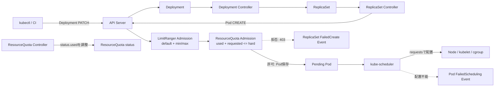

[[Home]]

# Weekly Kubernetes Magazine — Namespaceの資源予算を「拒否理由まで説明できる」状態にする

> **今週の単一評価基準**：`LimitRange` と `ResourceQuota` を組み合わせ、コンテナ単位の既定値・上下限とNamespace全体の予算を設計し、DeploymentのPodが増えない事象を **admission拒否／scheduler Pending／実行時枯渇** に切り分け、証拠を残して安全に復旧できること。

#kubernetes #k8s #weekly #deep-dive

> [!warning] apply / scale / delete 前の安全確認
> このラボは専用Namespace `k8s-budget-lab`を作成し、意図的にPod作成を失敗させ、最後にNamespaceを削除する。**共有・本番クラスタでは実行しない**。変更の直前に `kubectl config current-context` と対象Namespaceを確認すること。サンプルに実在のSecretは含めない。トークン、パスワード、証明書、クラウド認証情報をYAML・コマンド・ログへ貼らない。

## 1. Focus、難易度、前提、クラスタ要件、測定可能な到達点

### Focusと難易度シグナル

- **Focus**：NamespaceのCPU／memory予算を、`LimitRange`（1コンテナの境界と既定値）と`ResourceQuota`（Namespace合計）で実装し、拒否をイベントから診断する。
- **Difficulty: Intermediate**：学習順の門ではなく目安。Pod、Deployment、requests／limitsが分かれば取り組める。

### 必要な知識・先行概念

1. DeploymentはReplicaSetを介してPod数を継続的にdesired stateへ近づける。
2. CPU `100m`は0.1 CPU、memory `128Mi`は128 mebibytesを表す。
3. `request`は主にschedulerの配置判断、`limit`は主にnode上の実行制御に使われる。
4. API admissionで拒否されたオブジェクトは保存されない。したがって「PodがPending」になる前に失敗する場合がある。

### 必要ツール・環境

- `kubectl`（クラスタと互換性のある版）
- 学習専用クラスタ：kind、minikube、Docker Desktopなど
- Namespaceを作成でき、`LimitRange`、`ResourceQuota`、Deployment、Service、Role／RoleBindingを作成できる権限
- 1 worker相当、allocatable CPU 1以上、memory 1Gi以上を推奨
- Metrics Serverは不要。`jq`も不要

事前検査：

```bash
kubectl version
kubectl config current-context
kubectl cluster-info
kubectl auth can-i create namespaces
kubectl auth can-i create limitranges --namespace=k8s-budget-lab
kubectl auth can-i create resourcequotas --namespace=k8s-budget-lab
kubectl get nodes -o custom-columns=NAME:.metadata.name,CPU:.status.allocatable.cpu,MEMORY:.status.allocatable.memory
```

### 測定可能な到達点

ラボ後、次を実物の出力で示せること：

- resources未指定PodにLimitRangeの既定値が注入されたことをJSONPathで確認する。
- quotaの`hard`と`used`を読み、あと何Pod作成できるか計算する。
- replicasを増やしてもPodが増えない事象を、Deployment／ReplicaSetイベントの`FailedCreate`と`exceeded quota`で特定する。
- admission拒否とschedulerの`FailedScheduling`を区別する。
- desired replicasを安全値に戻し、Available replicasとquota使用量が回復したことを検証する。
- 運用者向け最小権限Roleで、予算・Pod・イベントは読めるが変更できないことを確認する。

### 学習レイヤー

1. **Foundation**：requests／limits、LimitRange、ResourceQuota、admissionの役割を区別する。
2. **Practical implementation**：専用Namespaceへ予算とworkloadを適用し、既定値注入と使用量を確認する。
3. **Production concerns**：SLO、権限、容量、コスト、既存Pod、複数LimitRangeの危険を扱う。
4. **Optional advanced challenge**：PriorityClassやquota scopeを用いて重要workloadの予算を分離する。

## 2. 本番シナリオ、SLO、失敗仮定

### シナリオ

共有クラスタ上のteam-a NamespaceにはAPIが複数ある。新しいDeploymentがresourcesを省略したまま大量にscaleされると、schedulerが過密配置し、node pressure時に既存サービスまで不安定になる。逆に厳しすぎるquotaでは、正当なローリング更新のsurge Podが作れず、更新が停止する。

この号では、次の予算モデルを作る：

- 1コンテナの既定値：request `100m / 128Mi`、limit `200m / 256Mi`
- 1コンテナの上限：CPU `500m`、memory `512Mi`
- Namespace合計：requests `500m / 640Mi`、limits `1 CPU / 1280Mi`
- Pod数上限：5
- baseline：2 replicas。意図的に6 replicasへ拡大すると、3つだけ追加され、残りはquotaで拒否される。

### 仮想SLO／運用指標

- 通常時：Deploymentの`availableReplicas / spec.replicas = 100%`。
- resource予算：`used / hard <= 80%`を警告、`>= 90%`をページング候補とする。
- 変更成功：rollout開始から5分以内にdesired replicasがAvailableになる。
- 診断目標：Pod不足の検知から10分以内に、拒否層と拒否理由を特定する。
- 復旧目標：誤scaleの検知から15分以内に安全なdesired stateへ戻す。

### failure assumptions

- quota controllerとLimitRanger admission pluginは通常の配布で有効。
- API serverへ到達でき、etcdは正常。
- image pullは可能。レジストリ障害は別の失敗モード。
- baseline 2 Podがnodeへ配置できるだけのallocatable資源がある。
- `ResourceQuota`はNamespaceの公平性を保証するが、node容量を増やさない。
- quota変更はすでに動いているPodを再作成・縮小しない。

## 3. Control planeとreconciliationのメンタルモデル

`kubectl scale deployment budget-web --replicas=6`が成功しても、6 Podが作れるとは限らない。

1. API serverがDeploymentの`spec.replicas=6`を保存する。
2. Deployment controllerがReplicaSetのdesired replicasを6にする。
3. ReplicaSet controllerが不足PodのCREATEをAPI serverへ送る。
4. admissionでLimitRangeがresources未指定コンテナへ既定値を注入し、min／max／比率を検証する。
5. ResourceQuota admissionが「作成後の合計がhard以下か」を評価する。
6. 予算内ならPodが保存される。予算超過ならCREATEは`403 Forbidden`で拒否され、Podオブジェクトは存在しない。
7. 保存された未配置Podだけをschedulerが評価する。nodeにrequest分の空きがなければPodは`Pending`となり、`FailedScheduling`イベントが付く。
8. 配置後、kubeletとruntimeがコンテナを起動し、CPU limitやmemory limitをcgroupで適用する。

つまり、証拠の場所が異なる：

| 層 | 典型状態 | 一次証拠 | 代表原因 |
|---|---|---|---|
| API admission | 欲しいPodそのものがない | ReplicaSetの`FailedCreate`イベント | exceeded quota、LimitRange違反 |
| Scheduler | Podは存在し`Pending` | Podの`FailedScheduling`イベント | Insufficient cpu/memory、taint、affinity |
| Kubelet/runtime | Podは配置済み | Pod status、container state、nodeイベント | OOMKilled、CPU throttling、image pull |

`ResourceQuota.status.used`はcontrollerが観測して更新するため、作成直後に短い遅延があり得る。最終的にdesired stateへ収束するというreconciliationの見方が重要である。

## 4. 設計オプションとトレードオフ

### A. resourcesを各workloadへ明示する

- 長所：Git上で性能意図をレビューできる。アプリごとの実測値を反映しやすい。
- 短所：記載漏れが起こる。共通の最低線を維持しにくい。
- 推奨：**明示を原則**にし、LimitRangeのdefaultは安全網とする。既定値を性能設計の代替にしない。

### B. LimitRangeでdefaultRequest／defaultを注入する

- 長所：resources省略を無制限のまま通さない。quotaと組み合わせやすい。
- 短所：提出YAMLと保存されたPod specが異なる。defaultが過大だと容量を無駄にし、過小だと過密配置になる。
- 注意：複数LimitRangeがある場合、どのdefaultが適用されるかは決定的でない。Namespaceあたり一つの所有ルールにする。

### C. ResourceQuotaでrequests／limits合計を制限する

- 長所：一つのteamが共有クラスタ全体を占有するblast radiusを抑える。
- 短所：rollout surge、Job並列数、障害時の一時増員も予算を消費する。hard到達時にcontrollerのPod CREATEが止まる。
- 設計式の例：`定常Pod + maxSurge + バッチ最大並列 + 緊急余白`を合計してhardを決める。

### D. Pod数quotaだけを使う

- 長所：大量Pod生成を単純に抑止できる。
- 短所：各Podの大きさを制御できない。CPU／memory quotaと併用する。

### E. requestsとlimitsを同値にする／overcommitする

- 同値：予測しやすくGuaranteed QoSを狙えるが、利用率とコストが悪化しやすい。
- overcommit：資源効率は上がるが、node pressure、CPU throttling、OOMのリスクが増える。
- 重要：quotaの`requests.*`と`limits.*`は予約／上限の帳簿であり、実使用量メトリクスではない。

## 5. Architecture／object relationship



関係の要点：LimitRangeとResourceQuotaはDeploymentを直接縮小しない。各Pod CREATEを変異・検証・集計する。よってDeploymentのdesiredとactualに差が残り、controllerイベントに失敗が現れる。

## 6. Guided lab（150分）

### 時間配分

- 0–20分：Foundation、安全確認とmanifestレビュー
- 20–55分：Practical implementation、適用とdefault注入確認
- 55–90分：quota帳簿とRBAC検証
- 90–125分：failure injection、証拠採取、rollback
- 125–150分：Production review、cleanup、成果物整理

### 6.1 Step 0 — contextと権限を確認する（10分）

```bash
kubectl config current-context
kubectl config view --minify --output 'jsonpath={..namespace}{"\n"}'
kubectl auth can-i create namespaces
kubectl get ns k8s-budget-lab 2>/dev/null || true
```

期待：学習用contextである。最後のコマンドは`NotFound`または既存Namespaceを表示する。既存なら以前の成果物を確認し、衝突を解消するまで進まない。

### 6.2 Step 1 — 完全manifestを保存する（10分）

以下を`budget-lab.yaml`として保存する。実在のSecretは一切入れない。

```yaml
apiVersion: v1
kind: Namespace
metadata:
  name: k8s-budget-lab
  labels:
    purpose: learning
---
apiVersion: v1
kind: LimitRange
metadata:
  name: container-guardrails
  namespace: k8s-budget-lab
spec:
  limits:
    - type: Container
      defaultRequest:
        cpu: 100m
        memory: 128Mi
      default:
        cpu: 200m
        memory: 256Mi
      min:
        cpu: 50m
        memory: 64Mi
      max:
        cpu: 500m
        memory: 512Mi
      maxLimitRequestRatio:
        cpu: "4"
        memory: "4"
---
apiVersion: v1
kind: ResourceQuota
metadata:
  name: team-budget
  namespace: k8s-budget-lab
spec:
  hard:
    requests.cpu: 500m
    requests.memory: 640Mi
    limits.cpu: "1"
    limits.memory: 1280Mi
    pods: "5"
    count/services: "2"
---
apiVersion: apps/v1
kind: Deployment
metadata:
  name: budget-web
  namespace: k8s-budget-lab
  labels:
    app: budget-web
spec:
  replicas: 2
  strategy:
    type: RollingUpdate
    rollingUpdate:
      maxUnavailable: 0
      maxSurge: 1
  selector:
    matchLabels:
      app: budget-web
  template:
    metadata:
      labels:
        app: budget-web
    spec:
      containers:
        - name: web
          image: registry.k8s.io/e2e-test-images/agnhost:2.53
          args: ["netexec", "--http-port=8080"]
          ports:
            - name: http
              containerPort: 8080
          readinessProbe:
            httpGet:
              path: /healthz
              port: http
            periodSeconds: 3
            failureThreshold: 3
          # 教材上、resourcesを意図的に省略する。
          # 保存時にLimitRangeがdefaultRequest/defaultを注入する。
---
apiVersion: v1
kind: Service
metadata:
  name: budget-web
  namespace: k8s-budget-lab
spec:
  selector:
    app: budget-web
  ports:
    - name: http
      port: 80
      targetPort: http
---
apiVersion: v1
kind: ServiceAccount
metadata:
  name: budget-observer
  namespace: k8s-budget-lab
automountServiceAccountToken: false
---
apiVersion: rbac.authorization.k8s.io/v1
kind: Role
metadata:
  name: budget-observer
  namespace: k8s-budget-lab
rules:
  - apiGroups: [""]
    resources: ["pods", "pods/status", "events", "resourcequotas", "limitranges", "services"]
    verbs: ["get", "list", "watch"]
  - apiGroups: ["apps"]
    resources: ["deployments", "replicasets"]
    verbs: ["get", "list", "watch"]
---
apiVersion: rbac.authorization.k8s.io/v1
kind: RoleBinding
metadata:
  name: budget-observer
  namespace: k8s-budget-lab
subjects:
  - kind: ServiceAccount
    name: budget-observer
    namespace: k8s-budget-lab
roleRef:
  apiGroup: rbac.authorization.k8s.io
  kind: Role
  name: budget-observer
```

YAMLの読み方：

- `defaultRequest`は省略されたrequest、`default`は省略されたlimitをコンテナへ注入する。
- `min`／`max`はコンテナ一つの境界。Namespace合計ではない。
- `maxLimitRequestRatio: "4"`はlimit/request比を最大4倍にする。quantityなので文字列が安全。
- quotaの`requests.*`／`limits.*`は全Podコンテナの合計。`pods`と`count/services`はオブジェクト数を数える。
- Deploymentにresourcesを省略したのは、mutationを観察するため。本番manifestでは明示する。
- `automountServiceAccountToken: false`により、観測SAを使うPodが自動的にAPI tokenを持つことを防ぐ。RoleBindingは権限を与えるが、tokenを配る設定ではない。

### 6.3 Step 2 — server-side dry-run後に適用する（15分）

> [!warning] apply直前
> `kubectl config current-context`を再確認する。次のapplyは`k8s-budget-lab`を新規作成する。

```bash
kubectl config current-context
kubectl apply --dry-run=server -f budget-lab.yaml
kubectl diff -f budget-lab.yaml || true
kubectl apply -f budget-lab.yaml
kubectl -n k8s-budget-lab rollout status deployment/budget-web --timeout=120s
kubectl -n k8s-budget-lab get deploy,rs,pod,svc
```

期待出力の骨格：

```text
deployment "budget-web" successfully rolled out
NAME                         READY   UP-TO-DATE   AVAILABLE
deployment.apps/budget-web   2/2     2            2
...
pod/budget-web-...           1/1     Running
pod/budget-web-...           1/1     Running
service/budget-web           ClusterIP ... 80/TCP
```

Checkpoint A：Podが2つRunningでなければ先へ進まず、`kubectl describe pod`とイベントを確認する。

### 6.4 Step 3 — admissionによるdefault注入を検証する（20分）

提出したDeployment templateと、生成後Podを比較する：

```bash
kubectl -n k8s-budget-lab get deploy budget-web \
  -o jsonpath='{.spec.template.spec.containers[0].resources}{"\n"}'

kubectl -n k8s-budget-lab get pods -l app=budget-web \
  -o jsonpath='{range .items[*]}{.metadata.name}{"\trequest="}{.spec.containers[0].resources.requests}{"\tlimit="}{.spec.containers[0].resources.limits}{"\n"}{end}'

kubectl -n k8s-budget-lab describe limitrange container-guardrails
```

期待：Deployment templateのresourcesは空のままだが、各Podには次がある。

```text
request={"cpu":"100m","memory":"128Mi"} limit={"cpu":"200m","memory":"256Mi"}
```

これはLimitRangeがDeploymentを変更したのではなく、ReplicaSet controllerが送った**Pod CREATE**をadmission時に変更した証拠である。

### 6.5 Step 4 — quota帳簿と最小権限を確認する（15分）

```bash
kubectl -n k8s-budget-lab get resourcequota team-budget
kubectl -n k8s-budget-lab describe resourcequota team-budget
kubectl -n k8s-budget-lab get resourcequota team-budget \
  -o jsonpath='{range .status.hard}{@}{end}{"\n"}{range .status.used}{@}{end}{"\n"}'

kubectl auth can-i --as=system:serviceaccount:k8s-budget-lab:budget-observer \
  list pods --namespace=k8s-budget-lab
kubectl auth can-i --as=system:serviceaccount:k8s-budget-lab:budget-observer \
  patch deployments.apps --namespace=k8s-budget-lab
kubectl auth can-i --as=system:serviceaccount:k8s-budget-lab:budget-observer \
  get secrets --namespace=k8s-budget-lab
```

期待値：2 Podなので概ね次になる（ServiceAccount自身はquota対象に含めていない）。

```text
Resource         Used    Hard
limits.cpu       400m    1
limits.memory    512Mi   1280Mi
pods             2       5
requests.cpu     200m    500m
requests.memory  256Mi   640Mi
services         1       2
```

`can-i`は順に`yes`、`no`、`no`。observerは診断情報を読めるがscaleやSecret閲覧はできない。

Checkpoint B：`used`が期待より多いなら、ラベルだけでなくNamespace全体のPodを列挙する。quotaはDeployment単位でなくNamespace全体を集計する。

## 7. kubectlとYAMLの重要ポイント

### `kubectl get`はdesiredとactualを同時に読む

```bash
kubectl -n k8s-budget-lab get deployment budget-web \
  -o custom-columns=DESIRED:.spec.replicas,UPDATED:.status.updatedReplicas,READY:.status.readyReplicas,AVAILABLE:.status.availableReplicas,UNAVAILABLE:.status.unavailableReplicas
```

`DESIRED=6, AVAILABLE=5, UNAVAILABLE=1`は「controllerが諦めた」意味ではない。desiredへ近づけようと再試行しているが、下流で拒否されている可能性がある。

### `describe`はcontrollerイベントを読む

Podが存在しなければ`kubectl describe pod`はできない。所有者を上へたどる：Deployment → ReplicaSet → event。

```bash
kubectl -n k8s-budget-lab describe deployment budget-web
kubectl -n k8s-budget-lab get rs -l app=budget-web
kubectl -n k8s-budget-lab describe rs -l app=budget-web
kubectl -n k8s-budget-lab get events --sort-by=.metadata.creationTimestamp
```

### `requests`と`limits`は用途が違う

- schedulerはrequestを足し合わせて配置可能性を評価する。
- CPU limitは通常throttling、memory limit超過はpressure下でOOM killにつながり得る。
- quotaは実使用率でなく宣言値を集計する。CPUがidleでもquotaが空くわけではない。
- limitだけ指定しrequestを省略した場合、別のadmission既定値がなければKubernetesがlimitをrequestとしてコピーする挙動がある。暗黙動作へ依存せず明示する。

## 8. Failure injectionと証拠駆動incident／rollback演習（35分）

### 8.1 仮説を記録する

scaleを6にすると、default requestにより必要量は`600m / 768Mi`、Pod数は6になる。hardは`500m / 640Mi / 5 Pods`なので最大5 Podで止まるはずである。

### 8.2 故障を注入する

> [!warning] scale直前
> contextとNamespaceを確認する。CPU／memory負荷を生成する演習ではないが、Pod数を増やすため小さな費用が発生し得る。

```bash
kubectl config current-context
kubectl -n k8s-budget-lab get deploy budget-web
kubectl -n k8s-budget-lab scale deployment/budget-web --replicas=6
kubectl -n k8s-budget-lab rollout status deployment/budget-web --timeout=30s || true
```

期待：rollout statusはtimeoutし得る。Podは5つ、Deployment desiredは6のまま。

### 8.3 証拠を固定順で集める

```bash
kubectl -n k8s-budget-lab get deployment budget-web \
  -o custom-columns=DESIRED:.spec.replicas,READY:.status.readyReplicas,AVAILABLE:.status.availableReplicas,UNAVAILABLE:.status.unavailableReplicas
kubectl -n k8s-budget-lab get pods -l app=budget-web -o wide
kubectl -n k8s-budget-lab get rs -l app=budget-web
kubectl -n k8s-budget-lab describe rs -l app=budget-web
kubectl -n k8s-budget-lab describe resourcequota team-budget
kubectl -n k8s-budget-lab get events --sort-by=.metadata.creationTimestamp | tail -30
```

決定的証拠の例：

```text
Warning  FailedCreate  replicaset-controller  Error creating: pods "budget-web-..." is forbidden:
exceeded quota: team-budget, requested: pods=1,requests.cpu=100m,requests.memory=128Mi,
used: pods=5,requests.cpu=500m,requests.memory=640Mi,
limited: pods=5,requests.cpu=500m,requests.memory=640Mi
```

この時、6個目のPodはAPIに保存されていない。したがってPending Podや`FailedScheduling`を探し続けるのは誤りである。

### 8.4 反証チェック：scheduler障害との区別

```bash
kubectl -n k8s-budget-lab get pods --field-selector=status.phase=Pending
kubectl -n k8s-budget-lab get events --field-selector=reason=FailedScheduling
```

期待：quota failureだけなら該当なし。もしPending Podと`Insufficient cpu`があれば、それはadmissionを通過した別の配置問題であり、node allocatable、既存Pod requests、taintsを調べる。

### 8.5 rollbackする

予算増額は事業判断とcapacity reviewが必要なので、incident中の最初の復旧策は誤ったdesired stateを戻す。

> [!warning] scale直前
> context、Namespace、現在のdesired／availableを確認する。

```bash
kubectl config current-context
kubectl -n k8s-budget-lab get deploy budget-web
kubectl -n k8s-budget-lab scale deployment/budget-web --replicas=2
kubectl -n k8s-budget-lab rollout status deployment/budget-web --timeout=120s
kubectl -n k8s-budget-lab get deploy,rs,pod
kubectl -n k8s-budget-lab describe resourcequota team-budget
kubectl -n k8s-budget-lab get events --sort-by=.metadata.creationTimestamp | tail -20
```

成功条件：desired／ready／availableがすべて2。Podが2つ。quota usedが`200m / 256Mi / 2 pods`へ戻る。過去のWarningイベントが残るのは正常で、事後分析の証拠になる。

### Incidentメモの最小テンプレート

```text
検知: Deployment desired 6 / available 5
影響: 既存5 PodはReady、追加1 Podが作れずcapacity headroomなし
拒否層: API admission（Podオブジェクトなし）
証拠: ReplicaSet FailedCreate / exceeded quota team-budget
直接原因: requests.cpu, requests.memory, podsのhard到達
復旧: replicas 6 -> 2、rollout complete、quota used回復
恒久対応候補: surgeを含む予算式、alert、変更前policy check
```

## 9. Security、RBAC、Namespace／context、resource、cost

### SecurityとRBAC

- Namespaceを作る権限、ResourceQuotaを変える権限、workloadを作る権限は分離する。アプリ運用者が自分でhardを上げられると統制にならない。
- 診断RoleにSecretの`get/list/watch`を与えない。event本文にもアプリが機密を出さないようにする。
- `kubectl auth can-i`は権限設計の証拠。`--as`のimpersonate自体にも権限が必要で、Forbiddenなら管理者に確認する。
- admission policy変更は新規CREATE／UPDATEへ作用するが、既存Podへ遡及しない。policy導入前にinventoryを取る。

### Namespaceとcontext

- すべてのnamespaced objectに`metadata.namespace`を明記し、コマンドでも`-n`を明記する。
- `kubectl config set-context --current --namespace=...`は便利だが、暗黙Namespaceに依存しない。
- `default`、`kube-system`、本番Namespaceで演習しない。

### Resourceとcost

- request過大：bin packingが悪化し、node増設・クラウド費用増につながる。
- request過小：過密配置、CPU競合、memory pressure、evictionのリスク。
- limit過小：CPU throttlingやOOMKilled。limit過大：blast radius増。
- quota hardを定常値ぴったりにするとRollingUpdateの`maxSurge`が止まる。更新時の一時容量を計上する。
- HPAの`maxReplicas`とquotaが矛盾すると、HPA desiredが増えてもPod CREATEが拒否される。容量設計を共同管理する。
- quotaは請求上限そのものではない。node、LoadBalancer、PVC、外部APIなどのコストも別に管理する。

## 10. Apply／delete安全規約

変更前の共通チェック：

```bash
kubectl config current-context
kubectl config view --minify
kubectl -n k8s-budget-lab get all
```

- `apply`前：`--dry-run=server`と`kubectl diff`を実行する。
- `scale`前：対象Deploymentと現在値を表示する。
- `delete`前：削除対象Namespaceの全主要resourceを表示する。
- 実Secretをサンプルへ置かない。ダミー値でもbase64は暗号化ではない。
- 出力を共有するときはcontext名、クラスタendpoint、annotation、token、Secret dataを確認しredactする。

## 11. Verification checklistと成果物

### Checklist

- [ ] 学習用contextを確認した。
- [ ] `k8s-budget-lab`以外を変更していない。
- [ ] dry-runとdiff後にapplyした。
- [ ] baseline 2 PodがReadyになった。
- [ ] Podへ`100m/128Mi` requestと`200m/256Mi` limitが注入された。
- [ ] quota hard／usedを読み、最大5 Podと計算できた。
- [ ] observer SAがPod等を読め、Deployment変更とSecret閲覧ができないことを確認した。
- [ ] replicas=6でReplicaSet `FailedCreate`を採取した。
- [ ] Pending／FailedSchedulingではないことを反証した。
- [ ] replicas=2へ戻し、Availableとquota usedの回復を確認した。
- [ ] 実在のSecretや認証情報を保存していない。

### concrete deliverables

1. `budget-lab.yaml`
2. baseline時のPod resources JSONPath出力
3. baseline／failure／recoveryのResourceQuota `used/hard`
4. `FailedCreate`イベントを含むincidentメモ
5. `kubectl auth can-i` 3項目の結果
6. 「admission拒否とscheduler Pendingの見分け方」を3文で説明した運用メモ

## 12. Assessment、設計面接問題、follow-up challenge

### Q1. Deploymentがdesired 6なのにPodが5つしかなく、Pending Podもない。最初に何を見るか？

<details><summary>回答</summary>

Deployment配下のReplicaSetイベントを見る。Pod CREATEがadmissionで拒否されるとPodは保存されないため、PodイベントではなくReplicaSetの`FailedCreate`に`exceeded quota`やLimitRange違反が現れる。

</details>

### Q2. LimitRangeとResourceQuotaの責務の違いは？

<details><summary>回答</summary>

LimitRangeは主にNamespace内の個々のContainer／Pod／PVCに既定値、最小、最大、比率を適用する。ResourceQuotaはNamespace全体のrequests／limitsやオブジェクト数などの合計にhard ceilingを設ける。

</details>

### Q3. CPU使用率がほぼ0%なのにCPU quotaが満杯なのはなぜか？

<details><summary>回答</summary>

`requests.cpu`／`limits.cpu` quotaは実使用量でなくmanifest上の宣言値を合計するため。使用率を知るにはMetrics APIや監視基盤が別途必要。

</details>

### Q4. LimitRangeを追加したら既存Podのresourcesも自動更新されるか？

<details><summary>回答</summary>

されない。LimitRangeのvalidation／defaultingはPod admission時に働き、すでに存在するPodへ遡及しない。再作成時には新policyが適用されるため、rollout前に互換性を確認する。

</details>

### Q5. quota hardを定常2 Pod分ぴったりにすると、`maxSurge: 1`の更新で何が起こるか？

<details><summary>回答</summary>

surge PodのCREATEがquotaで拒否され、`maxUnavailable: 0`なら古いPodも先に減らせずrolloutが停止し得る。定常容量だけでなくsurge、Job、障害時余白を予算へ含める。

</details>

### Interview／design question

10チームが共有するクラスタで、各チームにResourceQuotaを配る設計を説明せよ。次を含めること：予算算定元、requestsの品質、rollout surge、HPA、Job、例外申請、quota使用率alert、権限分離、node capacityとの対応、コスト配賦。

良い回答は「全Namespaceへ同じ固定値」ではなく、実測・SLO・成長率からrequestを見直す仕組み、policy所有者、変更監査、hard到達前の予測alert、緊急時runbookまで扱う。

### Optional advanced challenge（30–60分）

PriorityClassを二つ用意し、ResourceQuotaの`scopeSelector`で優先度別に予算を分ける案を**別の学習用Namespace**で設計する。重要workloadの予約枠とbest-effort枠を分離し、次を検証する：

1. 各quotaがどのPodを集計するか。
2. HPA `maxReplicas`と優先度別hardの整合性。
3. 高priorityはscheduler上の優先順位であり、admission quotaを無視できないこと。
4. preemptionが他workloadのSLOへ与える影響。

## 13. Cleanup

> [!danger] 削除前に停止して確認
> 次はNamespace配下の全オブジェクトを削除する。名前が正確に`k8s-budget-lab`であること、学習用contextであること、必要な証拠を保存済みであることを確認する。

```bash
kubectl config current-context
kubectl get namespace k8s-budget-lab
kubectl -n k8s-budget-lab get all
kubectl -n k8s-budget-lab get limitrange,resourcequota,role,rolebinding,serviceaccount
kubectl delete namespace k8s-budget-lab --wait=true
kubectl get namespace k8s-budget-lab 2>&1 || true
```

期待：最後は`namespaces "k8s-budget-lab" not found`。Terminatingが長引く場合、finalizerを力ずくで外さず、残存resourceとcontroller状態を診断する。

## 14. 現行公式Kubernetesリファレンス

- [Resource Quotas](https://kubernetes.io/docs/concepts/policy/resource-quotas/)
- [Limit Ranges](https://kubernetes.io/docs/concepts/policy/limit-range/)
- [Resource Management for Pods and Containers](https://kubernetes.io/docs/concepts/configuration/manage-resources-containers/)
- [Configure Memory and CPU Quotas for a Namespace](https://kubernetes.io/docs/tasks/administer-cluster/manage-resources/quota-memory-cpu-namespace/)
- [Manage Memory, CPU, and API Resources](https://kubernetes.io/docs/tasks/administer-cluster/manage-resources/)
- [ResourceQuota API reference](https://kubernetes.io/docs/reference/kubernetes-api/core-resources/resource-quota-v1/)
- [Share a Cluster with Namespaces](https://kubernetes.io/docs/tasks/administer-cluster/namespaces/)
- [Using RBAC Authorization](https://kubernetes.io/docs/reference/access-authn-authz/rbac/)
- [Admission Controllers](https://kubernetes.io/docs/reference/access-authn-authz/admission-controllers/)

---

**今週の要約**：資源予算の運用力はYAMLを置くことではなく、desiredとactualの差からcontrollerをたどり、`FailedCreate`をadmission拒否の証拠として読み、schedulerやruntimeの失敗と混同せずに復旧できることで測る。
