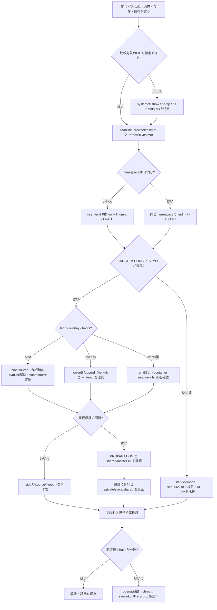

[[Home]]

# Weekly Linux Deep-Dive — `findmnt` と mount namespace で「同じパスなのに見え方が違う」を解く

#linux #commands #operations #weekly #deep-dive

## 1. Weekly focus

**今週の焦点:** `findmnt`、`mount`、`unshare`、`nsenter`、`/proc/<PID>/mountinfo` を使い、プロセスごとに異なるマウント表を観測し、bind mount・overlay・mount propagation に起因する障害を切り分ける。

**難易度シグナル:** **Specialized** — 参加条件ではなく、名前空間と伝播を扱うため用語が多いという目安。

### 必要知識・ツール・環境

- **既知であるとよい概念:** 絶対パス、inode、PID、通常の UNIX 権限。以前扱った `namei`、`df` / `du` の知識は役立つが必須ではない。
- **ツール:** util-linux の `findmnt`, `mount`, `umount`, `unshare`, `nsenter`; procps の `ps`; coreutils の `stat`, `readlink`, `sha256sum`。
- **環境:** Linux。演習は一時ディレクトリを使う。rootless user namespace が許可される環境が望ましい。コンテナ、WSL、強化済みホストでは `unshare` が拒否されることがある。
- **権限:** 観察は一般ユーザーで可能。別ユーザーの名前空間への `nsenter`、ホスト上の mount 操作には通常 root または `CAP_SYS_ADMIN` が必要。

### 測定可能な到達目標

終了時に次を実演できること。

1. あるパスを提供する mount の source、fstype、options、mount ID を特定する。
2. 2プロセスの mount namespace ID と mount table を比較する。
3. bind mount で「元ファイルが隠れる」障害を再現し、プロセス視点で証明する。
4. `shared` / `slave` / `private` の伝播属性を読み、変更前後を検証する。
5. アンマウント後に、想定した元データが再び見えることをハッシュで確認する。

---

## 2. Mental model — パスはファイルそのものではない

ユーザー空間のプロセスが `/srv/app/config.yml` を開くとき、カーネルの VFS は概ね次を行う。

1. プロセスの **mount namespace** が持つ mount table を選ぶ。
2. `/` からパス要素をたどる。
3. mount point に到達したら、その mount のルートへ乗り換える。
4. dentry と inode を解決し、通常の DAC/ACL/LSM 権限を評価する。

したがって、文字列として同じ `/srv/app/config.yml` でも、別 namespace のプロセスは別 inode・別 filesystem を見ることがある。`ls -l` が正しくても、**調査者とサービスが異なる mount table を見ていれば証拠にならない**。

```text
process A ── mnt:[4026531841] ── /srv/app -> /dev/sda2 のディレクトリ
process B ── mnt:[4026533007] ── /srv/app -> bind mount /releases/v2
                              └─ 同じパス文字列、異なる実体
```

重要な区別:

- **filesystem:** inode とデータを提供する仕組み（ext4, xfs, tmpfs, overlay など）。
- **mount:** filesystem の一部をディレクトリ木の場所へ接続したインスタンス。
- **mount namespace:** プロセス群が共有する mount の見え方。
- **bind mount:** 既存のディレクトリ木を別パスにも接続する。同一 filesystem でも mount は別。
- **overlayfs:** lower/upper/work を合成し、一つの merged view を提供する。コンテナで多用される。
- **propagation:** ある mount で生じた子 mount を peer namespace へ伝える規則。

`chroot` はルート探索の起点を変えるが、単独では namespace を作らない。コンテナも魔法ではなく、mount/PID/network など複数 namespace と cgroup、capability を組み合わせたプロセスである。

---

## 3. Production scenario と調査仮説

### シナリオ

デプロイ後、ホスト上の `/srv/payments/config.yml` は新しい内容で SHA-256 も正しい。しかしコンテナ化された worker だけ旧 DB エンドポイントを読み続ける。再起動しても直らない。権限エラーはなく、設定ファイルの pathname も一致する。

### 仮説

1. worker の mount namespace では `/srv/payments` に別の bind mount が重なっている。
2. bind source が古い release を指す。ホスト側 symlink の更新は、既に作られた bind mount の参照先を変えない。
3. orchestrator が `MS_PRIVATE` 相当で namespace を作り、ホスト側の後続 mount が worker へ伝播していない。
4. overlayfs の lower layer をホスト側から見ており、worker は upper layer の同名ファイルを見ている。

### 最初に集める証拠

```bash
pid=$(pgrep -xo payments-worker) || exit 1
readlink "/proc/$pid/ns/mnt"
findmnt -T /srv/payments/config.yml -o TARGET,SOURCE,FSTYPE,OPTIONS,PROPAGATION
sudo nsenter -t "$pid" -m -- findmnt -T /srv/payments/config.yml -o TARGET,SOURCE,FSTYPE,OPTIONS,PROPAGATION
sha256sum /srv/payments/config.yml
sudo nsenter -t "$pid" -m -- sha256sum /srv/payments/config.yml
```

2つのハッシュと `SOURCE` が違えば、「アプリのキャッシュ」より前に mount view の差を説明できる。

---

## 4. Primary tool: `findmnt` と関連コマンド

### `findmnt` が主役である理由

`mount` 引数なしでも一覧は出るが、可読性や機械処理の面で `findmnt` が優れる。既定では `/proc/self/mountinfo`、`/proc/self/mounts`、`/etc/fstab` などを読み、tree、検索、列選択、JSON 出力を提供する。調査では「どの mount がこのパスを支配するか」を `-T` で聞くのが最短である。

### 関連コマンドの役割

- `mount`: mount の作成、bind、remount、propagation 属性変更。
- `umount`: mount を外す。対象が busy なら参照中プロセスの調査が先。
- `unshare`: 新しい namespace を作ってコマンドを起動。
- `nsenter`: 既存プロセスの namespace に入って、その視点でコマンドを実行。
- `readlink /proc/PID/ns/mnt`: namespace オブジェクトの ID を比較。
- `/proc/PID/mountinfo`: mount ID、親 ID、major:minor、root、mount point、optional fields、fstype、source を持つカーネル由来の詳細情報。
- `stat`: パスが解決された後の device/inode を比較。
- `fuser` / `lsof`: `EBUSY` の参照元を調べる。

---

## 5. 重要な flags・出力・終了コード・権限・移植性

### `findmnt`

- `-T, --target <path>`: パスを含む filesystem を特定。対象が mount point そのものでなくてもよい。
- `-M, --mountpoint <dir>`: mount point が完全一致する行を検索。
- `-S, --source <source>`: device、UUID、LABEL など source で検索。
- `-t <type>`: `ext4,xfs` のように fstype を絞る。`nooverlay` のような否定も実装依存に注意。
- `-o <columns>`: 出力列を固定。スクリプトでは必須に近い。
- `-r`: raw、`-n`: header なし、`-J`: JSON。人間向け tree をパースしない。
- `-R`: 指定 mount の submount を再帰表示。
- `--poll`: mount table の変更を監視。長期監視前に対応版を `findmnt --help` で確認。

主要列:

- `TARGET`: mount point。
- `SOURCE`: device または bind/擬似 filesystem の source 表示。
- `FSTYPE`: ext4, xfs, tmpfs, overlay, proc など。
- `OPTIONS`: `ro/rw`, `nosuid`, `nodev`, `noexec`, filesystem 固有 option。
- `PROPAGATION`: `shared`, `slave`, `private`, `unbindable`。
- `ID`, `PARENT`: `/proc/self/mountinfo` に対応する mount ID と親 ID。
- `MAJ:MIN`: backing device の device number。bind mount 同士では同じことがある。

終了コードは util-linux の版・問い合わせ形式で細部が異なるため、**0を成功、非0を「一致なしまたはエラー」として stderr と共に扱う**。存在判定なら次のように明示する。

```bash
if findmnt -rn -M /srv/payments >/dev/null; then
  echo mounted
else
  rc=$?; echo "not mounted or query failed: rc=$rc" >&2
fi
```

### `mount` / `umount` / `unshare` / `nsenter`

- `mount --bind old new`: subtree を別 target に bind。
- `mount --rbind old new`: submount も再帰的に bind。
- `mount --make-private target`: 後続 mount event を外へも内へも伝播しない。
- `mount --make-rslave target`: subtree 全体を slave にする。ホスト→namespace は受け、逆方向を抑える用途が多い。
- `umount target`: 通常の安全な解除。`umount -l` は参照が消えるまで切離しを遅延するため、原因を隠し得る。常用しない。
- `unshare --user --map-root-user --mount`: user namespace 内で root mapping を作り、mount namespace を作成。
- `nsenter -t PID -m -- command`: PID の mount namespace で command を実行。

**権限:** mount namespace 内の mount 操作にも、その namespace を所有する user namespace に対する `CAP_SYS_ADMIN` が必要。rootless user namespace を sysctl/LSMで禁止する環境では `unshare: Operation not permitted` になる。

**移植性:** これらは主に Linux/util-linux。macOS/BSD の mount 実装や jail は同一ではない。BusyBox の `findmnt`/`unshare` は option が限定される場合がある。`/proc/PID/mountinfo` は Linux 固有。systemd unit では `PrivateMounts=`, `ProtectSystem=`, `BindPaths=` などが暗黙の差を作り得る。

---

## 6. Guided lab（約150分）

> [!warning] 実行場所
> 本演習は一時ディレクトリと新規 namespace だけを使う。ホストの `/`, `/etc`, `/usr`, `/home` を mount target にしない。共有サーバーでは実施前に管理方針を確認する。

### Phase A — Foundation（25分）

#### 1. ツールと現在視点を確認

```bash
command -v findmnt mount umount unshare nsenter stat readlink sha256sum
findmnt --version
readlink /proc/self/ns/mnt
findmnt -T / -o TARGET,SOURCE,FSTYPE,OPTIONS,PROPAGATION
```

**期待:** `mnt:[数値]` が表示され、`/` の source/fstype が分かる。コンテナでは `overlay` でも正常。

#### 2. mount tree と raw data を対応づける

```bash
findmnt -o TARGET,SOURCE,FSTYPE,PROPAGATION | sed -n '1,25p'
findmnt -T /proc/self/mountinfo -o ID,PARENT,TARGET,MAJ:MIN,FSTYPE,SOURCE
sed -n '1,5p' /proc/self/mountinfo
```

`mountinfo` の区切り ` - ` より前は mount 固有、後ろは filesystem 固有。optional fields に `shared:N`, `master:N`, `propagate_from:N` が現れる。

**Checkpoint A:** `/proc/self/mountinfo` を提供する mount の ID、親 ID、fstype を記録する。

### Phase B — Practical implementation（55分）

#### 3. ラボ領域を作る

```bash
LAB_DIR=$(mktemp -d /tmp/mntlab.XXXXXX) || exit 1
chmod 700 "$LAB_DIR"
mkdir -p "$LAB_DIR/base/app" "$LAB_DIR/release-v2/app" "$LAB_DIR/view"
printf 'endpoint=db-old\n' >"$LAB_DIR/base/app/config.yml"
printf 'endpoint=db-new\n' >"$LAB_DIR/release-v2/app/config.yml"
printf '%s\n' "$LAB_DIR" > /tmp/mntlab-current
sha256sum "$LAB_DIR/base/app/config.yml" "$LAB_DIR/release-v2/app/config.yml"
```

**期待:** 2ファイルのハッシュが異なる。

#### 4. rootless mount namespace を起動

```bash
unshare --user --map-root-user --mount --fork \
  sh -c 'mount --make-rprivate /; exec sleep 7200' &
LAB_PID=$!
printf '%s\n' "$LAB_PID" >"$LAB_DIR/ns.pid"
sleep 1
readlink /proc/self/ns/mnt
readlink "/proc/$LAB_PID/ns/mnt"
```

**期待:** 2つの `mnt:[...]` が異なる。`Operation not permitted` なら後述の代替へ。

#### 5. namespace 内に bind mount を作る

```bash
nsenter -t "$LAB_PID" -m -U --preserve-credentials -- \
  mount --bind "$LAB_DIR/base" "$LAB_DIR/view"
nsenter -t "$LAB_PID" -m -U --preserve-credentials -- \
  findmnt -M "$LAB_DIR/view" -o ID,PARENT,TARGET,SOURCE,FSTYPE,OPTIONS,PROPAGATION
```

一部の util-linux/カーネル組合せでは `nsenter` に user namespace 指定が必要:

```bash
nsenter -t "$LAB_PID" -U -m --setuid 0 --setgid 0 -- \
  mount --bind "$LAB_DIR/base" "$LAB_DIR/view"
```

#### 6. 観測者による違いを証明

```bash
findmnt -rn -M "$LAB_DIR/view" -o TARGET,SOURCE || echo 'host: mountなし'
nsenter -t "$LAB_PID" -m -- findmnt -rn -M "$LAB_DIR/view" -o TARGET,SOURCE
test -e "$LAB_DIR/view/app/config.yml"; echo "host test rc=$?"
nsenter -t "$LAB_PID" -m -- cat "$LAB_DIR/view/app/config.yml"
nsenter -t "$LAB_PID" -m -- stat -c 'dev=%d inode=%i %n' "$LAB_DIR/view/app/config.yml"
stat -c 'dev=%d inode=%i %n' "$LAB_DIR/base/app/config.yml"
```

**期待:** ホストでは `view` は空、namespace 内では `endpoint=db-old`。namespace 内の view と host の base の device/inode は一致する。

**Checkpoint B:** 「pathname が同じでも namespace が違えば mount が違う」を、namespace ID・findmnt・hash/stat の3種類で説明する。

### Phase C — Production concerns（45分）

#### 7. デプロイ後も古い view が残る障害を注入

```bash
ln -sfn "$LAB_DIR/release-v2" "$LAB_DIR/current"
cat "$LAB_DIR/current/app/config.yml"
nsenter -t "$LAB_PID" -m -- cat "$LAB_DIR/view/app/config.yml"
sha256sum "$LAB_DIR/current/app/config.yml"
nsenter -t "$LAB_PID" -m -- sha256sum "$LAB_DIR/view/app/config.yml"
```

**期待:** `current` は new、既存 bind は old。symlink を更新しても bind mount は作成時に解決された mount tree を参照し続ける。

#### 8. source を明示的に切り替える

```bash
nsenter -t "$LAB_PID" -m -U --preserve-credentials -- \
  umount "$LAB_DIR/view"
nsenter -t "$LAB_PID" -m -U --preserve-credentials -- \
  mount --bind "$LAB_DIR/release-v2" "$LAB_DIR/view"
nsenter -t "$LAB_PID" -m -- cat "$LAB_DIR/view/app/config.yml"
nsenter -t "$LAB_PID" -m -- findmnt -T "$LAB_DIR/view/app/config.yml" \
  -o TARGET,SOURCE,FSTYPE,OPTIONS,PROPAGATION
```

**期待:** `endpoint=db-new`。変更は mount の入替えであり、ファイル内容の上書きではない。

#### 9. busy mount の原因を調べる

```bash
nsenter -t "$LAB_PID" -m -- sh -c "cd '$LAB_DIR/view' && sleep 300" &
HOLDER_PID=$!
sleep 1
nsenter -t "$LAB_PID" -m -U --preserve-credentials -- \
  umount "$LAB_DIR/view"; echo "umount rc=$?"
fuser -vm "$LAB_DIR/view" 2>&1 || true
kill "$HOLDER_PID" 2>/dev/null || true
wait "$HOLDER_PID" 2>/dev/null || true
```

`EBUSY` が再現されない環境もある。その場合は namespace 内から `fuser -vm` を実行する。PID namespace を分けていないため、PIDはホストと共通。

#### 10. cleanup と rollback

```bash
nsenter -t "$LAB_PID" -m -U --preserve-credentials -- \
  umount "$LAB_DIR/view" 2>/dev/null || true
kill "$LAB_PID" 2>/dev/null || true
wait "$LAB_PID" 2>/dev/null || true
findmnt -rn -M "$LAB_DIR/view" || true
rm -rf -- "$LAB_DIR"
rm -f -- /tmp/mntlab-current
```

> `rm -rf` は、`mktemp -d /tmp/mntlab.XXXXXX` が返した値をこのシェルで保持している場合だけ実行する。変数が空、`/tmp`、`/` なら実行しない。より安全にするなら `test -n "$LAB_DIR" && [[ $LAB_DIR == /tmp/mntlab.* ]]` を先に検証する。

**Checkpoint C:** `findmnt -rn -M "$LAB_DIR/view"` が無出力で、lab用 `sleep` が残っていないこと。

### rootless namespace が禁止されている場合（20分の代替）

本番ホストの設定を変更せず、既存サービスを観測する。

```bash
ps -eo pid,user,comm --sort=pid | sed -n '1,20p'
for p in /proc/[0-9]*/ns/mnt; do readlink "$p" 2>/dev/null; done | sort | uniq -c
findmnt -J -o TARGET,SOURCE,FSTYPE,OPTIONS,PROPAGATION > /tmp/findmnt-snapshot.json
systemctl show <unit-name> -p MainPID -p PrivateMounts -p RootDirectory -p RootImage -p BindPaths -p BindReadOnlyPaths
```

変更権限のある隔離 VM なら `sudo unshare --mount --fork sh -c 'mount --make-rprivate /; exec sleep 7200'` を使えるが、共有・本番ホストでは実施しない。

### Phase D — Optional advanced challenge（25分）

1. `findmnt -J` の JSON から `overlay` mount だけを `jq` で抽出する。
2. 2つの PID の `/proc/PID/mountinfo` を正規化して diff し、片方だけにある mount point を列挙する。
3. 実験 VM で `shared` と `private` の namespace を作り、子 mount が伝播する条件を観察する。

```bash
findmnt -J -t overlay -o TARGET,SOURCE,FSTYPE,OPTIONS | jq '.filesystems'
pid_a=$$; pid_b=<target-pid>
diff -u <(awk -F' - ' '{print $1 " | " $2}' "/proc/$pid_a/mountinfo") \
        <(awk -F' - ' '{print $1 " | " $2}' "/proc/$pid_b/mountinfo")
```

---

## 7. Troubleshooting decision tree



---

## 8. Copy-ready examples（解説付き）

1. **あるファイルを支配する mount を調べる**
   ```bash
   findmnt -T /var/lib/myapp/data.db -o TARGET,SOURCE,FSTYPE,OPTIONS
   ```
   mount point そのものを知らなくても最長一致で特定できる。

2. **完全一致する mount point の有無をスクリプトで確認**
   ```bash
   findmnt -rn -M /mnt/archive -o SOURCE,FSTYPE
   ```
   `-r -n` で装飾と見出しを除き、機械処理しやすくする。

3. **read-only / noexec などを一列ずつ確認**
   ```bash
   findmnt -T /opt/myapp/bin/worker -o TARGET,OPTIONS --list
   ```
   実行不可が mode bit ではなく `noexec` mount option かを確認できる。

4. **namespace ID を2プロセスで比較**
   ```bash
   readlink /proc/1/ns/mnt; readlink /proc/self/ns/mnt
   ```
   数値が同じなら同じ mount namespace オブジェクトを参照する。

5. **対象プロセスの視点で pathname を解決**
   ```bash
   sudo nsenter -t 1234 -m -- findmnt -T /app/config.yml -o TARGET,SOURCE,FSTYPE
   ```
   ホストの `findmnt` ではなく PID 1234 の mount table を使う。

6. **source と mount ID を kernel data で確認**
   ```bash
   awk -v p='/srv/app' '$5==p {print}' /proc/1234/mountinfo
   ```
   第5 field は mount point。ただし空白などは octal escape されるため、汎用 parser はエスケープ対応が必要。

7. **同じ pathname の実体を device/inode で比較**
   ```bash
   stat -Lc 'dev=%d inode=%i mode=%A %n' /srv/app/config.yml
   ```
   `-L` は symlink を追う。別 view との device/inode 差が実体差の証拠になる。

8. **submount を含む subtree を表示**
   ```bash
   findmnt -R /var/lib/containers -o TARGET,SOURCE,FSTYPE,PROPAGATION
   ```
   親だけでなく、その下に重なった mount を見落とさない。

9. **mount 状態をJSONスナップショット化**
   ```bash
   findmnt -J -o ID,PARENT,TARGET,SOURCE,FSTYPE,OPTIONS,PROPAGATION > /tmp/mounts.json
   ```
   インシデント前後の比較やチケット添付に向く。秘密を含む source/path がないか確認して共有する。

10. **bind mount を read-only にする（実験環境）**
    ```bash
    mount --bind /srv/releases/v42 /srv/app && mount -o remount,bind,ro /srv/app
    ```
    古いカーネル/util-linux との互換性のため2段階が一般的。失敗時に第1段だけ残っていないか確認する。

11. **systemd unit が namespace を作る設定を確認**
    ```bash
    systemctl show myapp.service -p MainPID -p PrivateMounts -p RootDirectory -p BindPaths -p BindReadOnlyPaths
    ```
    unit file断片だけでなく、drop-in 適用後の実効値を見る。

12. **mount table 変更を監視**
    ```bash
    findmnt --poll --first-only -o ACTION,TARGET,SOURCE,FSTYPE
    ```
    対応する util-linux で mount/umount event を待つ。自動化前に終了条件を設ける。

13. **busy の利用者を確認**
    ```bash
    sudo fuser -vm /mnt/data
    ```
    強制 kill はせず、PID・アクセス種別・サービス所有者を確認して停止手順へ進む。

14. **fstab の構文と解決結果を確認**
    ```bash
    findmnt --verify --verbose
    ```
    実 mount を変更せず `/etc/fstab` の問題を検査する。版によって警告内容は異なる。

---

## 9. Failure injection / diagnostic challenge

ラボの Phase B を残した状態で、別ターミナルの観測者に次だけ伝える。

> 「`$LAB_DIR/current/app/config.yml` は new だが、PID `$LAB_PID` の `$LAB_DIR/view/app/config.yml` は old。再現理由を、変更を加えず10分以内に証明せよ。」

提出すべき証拠:

1. 観測者と対象の mount namespace ID。
2. 双方の `findmnt -T` 結果。
3. 双方の SHA-256 と device/inode。
4. mount type/source に基づく根本原因。
5. rollback 可能な修正案と検証コマンド。

採点基準は「推測」ではなく、プロセス視点の出力で因果を示せたか。`cp` で内容を上書きするのは失敗とする。

---

## 10. Safety・rollback・破壊的操作の警告

- `mount`, `umount`, propagation 変更は実行中サービスの view を即時変更し得る。本番で直接試さない。
- `mount --make-rprivate /` を**ホストの初期 namespace で実行してはいけない**。演習では新規 namespace 内でのみ行う。
- `umount -l` は問題解決ではなく切離しの延期。`umount -f` はネットワーク filesystem 等でデータ損失・I/O異常のリスクがある。
- bind mount は target に元からあったファイルを削除せず「隠す」。解除すれば再び見える。隠れた状態で容量調査を誤らない。
- `mount --rbind` は予想以上の submount を複製する。解除には順序が必要になり得る。
- `/proc/PID/root` や namespace 内の path を不用意にアーカイブすると、意図しない filesystem 境界を越える。
- rollback は原則、作成した mount を逆順に通常の `umount` で外し、`findmnt` で消失を確認する。サービス管理下なら手動修正より unit/container 定義を直して再作成する。
- `rm -rf` の前に `findmnt -R <target>` が空であることと、対象がラボ専用ディレクトリであることを確認する。

---

## 11. Verification checklist と成果物

### Checklist

- [ ] 最新12号と主要テーマが重複していない。
- [ ] `readlink /proc/PID/ns/mnt` で調査者と対象の view を区別した。
- [ ] `findmnt -T` で TARGET/SOURCE/FSTYPE/OPTIONS/PROPAGATION を記録した。
- [ ] `/proc/PID/mountinfo` の mount ID・parent ID・optional fields を読めた。
- [ ] bind mount の前後で pathname、hash、device/inode を比較した。
- [ ] `shared` / `slave` / `private` の方向性を説明できた。
- [ ] 変更前に rollback command と対象 mount を確定した。
- [ ] cleanup 後、lab mount・process・directory が残っていない。

### Concrete deliverables

1. `mount-baseline.txt`: namespace ID と `findmnt` の5列。
2. `view-comparison.txt`: host/target PID の hash、device、inode の比較。
3. `root-cause.md`: 仮説、反証/証拠、根本原因、修正、rollback を各1段落。
4. `mounts-before.json` と `mounts-after.json`: `findmnt -J` の差分用 snapshot。
5. 失敗注入 challenge の5点の回答。

---

## 12. Five-question assessment

1. `findmnt -T /a/b/c` と `findmnt -M /a/b/c` の違いは何か。
2. 同じ `/app/config` が2プロセスで異なる内容になる最初の確認項目は何か。
3. bind mount target に元からあったファイルは mount 中に削除されるか。
4. `private` propagation は mount event をどちら向きに伝えるか。
5. `umount` が `target is busy` になったとき、最初に `umount -l` を選ぶべきでない理由は何か。

<details>
<summary>解答を表示</summary>

1. `-T` はそのパスを包含する filesystem/mount を最長一致で探す。`-M` は mount point が指定値と完全一致する行を探す。
2. `/proc/<PID>/ns/mnt` と `/proc/self/ns/mnt` のID比較。その後、対象PIDの namespace 内で `findmnt -T` を行う。
3. 削除されない。別の mount に隠され、unmount 後に再び見える。
4. 外から内にも内から外にも伝えない。再帰指定なら subtree に適用される。
5. lazy unmount は現在の参照が消えるまで実体を残し、参照元や停止順序の問題を隠す。まず `fuser`/`lsof`、cwd、open fd、submount を調べる。

</details>

---

## 13. Follow-up challenge と公式リファレンス

### Follow-up challenge

隔離VMで小さな systemd service を作り、`PrivateMounts=yes` と `BindReadOnlyPaths=/path/source:/app/config` を設定する。次を提出する。

- unit 起動前後の namespace ID。
- `systemctl show` の実効 sandbox 設定。
- host と service namespace の `findmnt -T` 比較。
- read-only が VFS mode bit ではなく mount option で効いている証明。
- unit停止後に mount が残らないことの確認。

### 公式・一次リファレンス

- `man 8 findmnt` / util-linux man page: <https://man7.org/linux/man-pages/man8/findmnt.8.html>
- `man 8 mount`: <https://man7.org/linux/man-pages/man8/mount.8.html>
- `man 8 unshare`: <https://man7.org/linux/man-pages/man8/unshare.8.html>
- `man 1 nsenter`: <https://man7.org/linux/man-pages/man1/nsenter.1.html>
- `man 7 mount_namespaces`: <https://man7.org/linux/man-pages/man7/mount_namespaces.7.html>
- `proc_pid_mountinfo(5)`: <https://man7.org/linux/man-pages/man5/proc_pid_mountinfo.5.html>
- Linux kernel shared subtree documentation: <https://www.kernel.org/doc/html/latest/filesystems/sharedsubtree.html>
- systemd.exec sandbox / filesystem namespacing: <https://www.freedesktop.org/software/systemd/man/latest/systemd.exec.html>

最後に覚える一文: **path は住所、mount namespace は地図である。同じ住所文字列でも、地図が違えば到着先は違う。**
